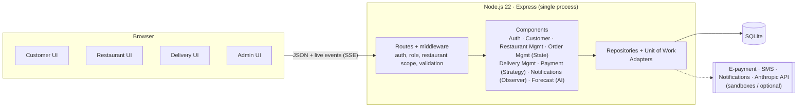

# FoodGO

**Order lunch in the morning, stay off the lunchtime roads.** FoodGO is a pre-order food delivery platform **only for Lac 3 / Zone Industrielle Le Kram** in Tunis (one area, known by both names). Traffic there gets heavy at lunchtime because employees leave work at the same time to get food. With FoodGO they pre-order before a deadline set by the restaurant and stay at their desks. At the deadline the kitchen knows exactly what to cook, and the restaurant's own delivery staff bring lunch at noon. The platform coordinates, the restaurant delivers. ([Why only this area](docs/decisions/0007-service-area-lac3-zi-kram.md))

**Team:** Hamza Ben Labiedh, Ali Chamakh, Mohamed Krid
**Course:** CS 488 — AI-First Software Engineering, MUST University, Fall 2026
**Status:** 🚧 In development — midterm MVP working, Sprint 2 next

[](https://github.com/HamzaBL04/foodGO/actions/workflows/ci.yml)

## What it does

| Role | Can do |
|---|---|
| **Customer** | Sign in with an SMS code, see only the restaurants that registered them, order before the deadline (cash or e-payment), follow the order live |
| **Restaurant staff** | Live order board, start preparing, assign to their own delivery people, AI-assisted prep forecast, menu and availability, in-person customer registration and eligibility, delivery team accounts, deadline and payment settings |
| **Delivery person** | See only their assigned orders, pickup and destination details, start and confirm delivery, record cash collected |
| **Administrator** | Create restaurants, provision staff accounts, monitor orders and the audit trail |

## Getting started

Requirements: **Git** and **Node.js 22.14 LTS or newer** (`node -v`). Nothing else: the database is a local SQLite file and every external service has a built-in sandbox.

```bash
# 1. Clone and enter the repo
git clone https://github.com/HamzaBL04/foodGO.git
cd foodGO

# 2. One-time setup (enables the git hooks; Windows: run in Git Bash)
./scripts/setup.sh

# 3. Copy the environment template (optional: every value has a default)
cp .env.example .env

# 4. Install dependencies
npm install

# 5. Run the app
npm start
```

Open **http://localhost:3000**. On first start the app creates a demo database with two restaurants, accounts and four weeks of order history. `npm run seed` resets it at any time.

```bash
npm test             # 100+ unit and integration tests
npm run coverage     # tests + coverage of all server code (CI requires >= 60 % lines)
npm run lint         # ESLint
```

**If `npm install` fails:** check `node -v` is 22.14 or newer. The SQLite driver ships prebuilt binaries for Windows, macOS and Linux; the project's `.npmrc` stops npm from trying to compile it, so no C++ toolchain is needed. If port 3000 is busy, run `PORT=3001 npm start` (PowerShell: `$env:PORT=3001; npm start`).

API documentation: **http://localhost:3000/api/docs** (Swagger UI, from [`docs/api/openapi.yaml`](docs/api/openapi.yaml)).

## Demo credentials

| Role | Sign in with | Password |
|---|---|---|
| Customer, 2 restaurants | `+21620111222` (Yasmine) | SMS code is shown on screen in demo mode |
| Customer | `+21698333444` (Omar) | SMS code is shown on screen |
| Restaurant staff, Dar Lella | `staff@darlella.tn` | `Staff#2026` |
| Restaurant staff, Kram Snack | `staff@kramsnack.tn` | `Staff#2026` |
| Delivery person, Dar Lella | `karim.d` | `Delivery#2026` |
| Administrator | `admin@foodgo.tn` | `Admin#2026` |

Dar Lella's demo deadline is 23:30 so ordering works at almost any hour. Kram Snack closes at 10:30, which shows a late order being refused.

## System diagram



Detailed diagrams (use-case, class, sequences, component) are in [`docs/uml`](docs/uml).

## Demo video

[`demo/foodgo-demo.mp4`](demo/foodgo-demo.mp4): a 2-minute captioned walkthrough of all four roles ([storyboard](demo/README.md)).

## Course deliverables

Code style: [`docs/STYLE_GUIDE.md`](docs/STYLE_GUIDE.md), enforced by ESLint in CI.

Everything the course asks for is indexed in [`docs/README.md`](docs/README.md): proposal, backlog and NFRs, traceability matrix, UML, OpenAPI, developer guide, user guide, refactor and optimisation report, AI usage log, ethics reflection, academic honesty statement, and the Lab 3 specification and Lab 4 SDD.

## Tech stack

Node.js 22.14+ · Express 5 · SQLite (better-sqlite3) · zod · helmet · plain HTML + ES modules · node:test + supertest + c8 · ESLint · GitHub Actions. Details and versions: [`AI_CONTEXT.md`](AI_CONTEXT.md); why: [ADR-0002](docs/decisions/0002-node-express-sqlite-stack.md).

## Project structure

<!-- STRUCTURE:START (auto-generated by scripts/update-structure.sh — do not edit by hand) -->
```
.
├── .cursor/
│   ├── rules/
├── .githooks/
│   ├── pre-push
├── .github/
│   ├── ISSUE_TEMPLATE/
│   ├── copilot-instructions.md
│   ├── pull_request_template.md
│   ├── workflows/
├── .vscode/
│   ├── extensions.json
│   ├── settings.sample.json
├── demo/
│   ├── README.md
│   ├── foodgo-demo.mp4
│   ├── record-demo.js
├── docs/
│   ├── ACADEMIC_HONESTY_STATEMENT.md
│   ├── CHANGELOG.md
│   ├── DEVELOPER_GUIDE.md
│   ├── README.md
│   ├── REFACTOR_AND_OPTIMIZATION_REPORT.md
│   ├── STYLE_GUIDE.md
│   ├── USER_GUIDE.md
│   ├── ai/
│   ├── api/
│   ├── architecture.md
│   ├── decisions/
│   ├── images/
│   ├── lab3-specification/
│   ├── lab4-sdd/
│   ├── metrics/
│   ├── proposal/
│   ├── requirements/
│   ├── setup-report.md
│   ├── setup.md
│   ├── uml/
├── scripts/
│   ├── benchmark.js
│   ├── check-docs.sh
│   ├── md-to-pdf.js
│   ├── metrics.js
│   ├── setup.sh
│   ├── traceability.js
│   ├── update-structure.sh
├── src/
│   ├── adapters/
│   ├── api/
│   ├── app.js
│   ├── components/
│   ├── config.js
│   ├── context.js
│   ├── db/
│   ├── domain/
│   ├── public/
│   ├── repositories/
│   ├── server.js
├── test/
│   ├── helpers.js
│   ├── integration/
│   ├── unit/
├── .cursorrules
├── .editorconfig
├── .env.example
├── .gitattributes
├── .gitignore
├── .npmrc
├── AI_CONTEXT.md
├── CLAUDE.md
├── CONTRIBUTING.md
├── LICENSE
├── README.md
├── eslint.config.js
├── package-lock.json
├── package.json
```
<!-- STRUCTURE:END -->

## Documentation

- [Architecture](docs/architecture.md) — how the system is put together
- [Setup details](docs/setup.md) — full environment setup and troubleshooting
- [Decisions (ADRs)](docs/decisions/) — why we chose what we chose
- [Changelog](docs/CHANGELOG.md) — what changed, when
- [Contributing / team workflow](CONTRIBUTING.md) — branches, commits, PRs, responsible AI use
- [AI assistant context](AI_CONTEXT.md) — the single file Copilot, Claude and Cursor read
- [All course deliverables](docs/README.md) — proposal, backlog, UML, API, guides, reports

## Team workflow (short version)

1. Never push to `main` (it is protected). Create a branch: `git checkout -b feat/short-name`.
2. Commit small, with clear messages (`feat:`, `fix:`, `docs:` …).
3. Open a Pull Request with the template; at least one teammate reviews before merge.
4. CI (lint + tests + coverage) must be green before merging.

Full details in [CONTRIBUTING.md](CONTRIBUTING.md).

## AI disclosure

This project was built with AI assistance (Claude, Anthropic), as the course encourages, from the team's own specification and design. AI-assisted commits carry a `Co-Authored-By` trailer; see [`docs/ai/AI_USAGE_LOG.md`](docs/ai/AI_USAGE_LOG.md) and [`docs/ai/ETHICS_AND_AI_REFLECTION.md`](docs/ai/ETHICS_AND_AI_REFLECTION.md). Inside the product, AI is used only for an advisory prep forecast for restaurants.
