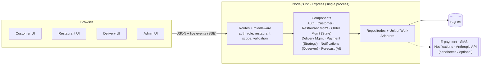

# FoodGO

**Order lunch in the morning, eat on time.** FoodGO is a pre-order food delivery platform for Tunisian offices and campuses. Customers pre-order before a deadline set by the restaurant; at the deadline the kitchen knows exactly what to cook, and the restaurant's own delivery staff bring lunch at noon. The platform coordinates, the restaurant delivers.

CS 488 AI-First Software Engineering, MUST University, Fall 2026. Team: Hamza Ben Labiedh, Ali Chamakh, Mohamed Krid.

[](https://github.com/HamzaBL04/foodGO/actions/workflows/ci.yml)

## What it does

| Role | Can do |
|---|---|
| **Customer** | Sign in with an SMS code, see only the restaurants that registered them, order before the deadline (cash or e-payment), follow the order live |
| **Restaurant staff** | Live order board, start preparing, assign to their own delivery people, AI-assisted prep forecast, menu and availability, in-person customer registration and eligibility, delivery team accounts, deadline and payment settings |
| **Delivery person** | See only their assigned orders, pickup and destination details, start and confirm delivery, record cash collected |
| **Administrator** | Create restaurants, provision staff accounts, monitor orders and the audit trail |

## Run it

Requirements: **Node.js 22 LTS or newer** (`node -v`). Nothing else: the database is a local SQLite file and every external service has a built-in sandbox.

```bash
git clone https://github.com/HamzaBL04/foodGO.git
cd foodGO
npm install
npm start
```

Open **http://localhost:3000**. On first start the app creates a demo database with two restaurants, accounts and four weeks of order history. `npm run seed` resets it at any time.

```bash
npm test             # 100+ unit and integration tests
npm run coverage     # tests + coverage report (CI requires >= 60 % lines)
npm run lint         # ESLint
```

API documentation: **http://localhost:3000/api/docs** (Swagger UI, from [`docs/api/openapi.yaml`](docs/api/openapi.yaml)).

## Demo credentials

| Role | Sign in with | Password |
|---|---|---|
| Customer, 2 restaurants | `+21620111222` (Yasmine) | SMS code is shown on screen in demo mode |
| Customer | `+21698333444` (Omar) | SMS code is shown on screen |
| Restaurant staff, Dar Lella | `staff@darlella.tn` | `Staff#2026` |
| Restaurant staff, Campus Bites | `staff@campusbites.tn` | `Staff#2026` |
| Delivery person, Dar Lella | `karim.d` | `Delivery#2026` |
| Administrator | `admin@foodgo.tn` | `Admin#2026` |

Dar Lella's demo deadline is 23:30 so ordering works at almost any hour. Campus Bites closes at 10:30, which shows a late order being refused.

## System diagram



Detailed diagrams (use-case, class, sequences, component) are in [`docs/uml`](docs/uml).

## Project documents

Everything the course asks for is in [`docs/`](docs/README.md): proposal, backlog and NFRs, traceability matrix, UML, OpenAPI, developer guide, user guide, refactor and optimisation report, AI usage log, ethics reflection, academic honesty statement, and the Lab 3 specification and Lab 4 SDD.

## Tech stack

Node.js 22 · Express 5 · SQLite (better-sqlite3) · zod · helmet · plain HTML + ES modules · node:test + supertest + c8 · ESLint · GitHub Actions.

## AI disclosure

This project was built with AI assistance (Claude, Anthropic), as the course encourages, from the team's own specification and design. AI-assisted commits carry a `Co-Authored-By` trailer; see [`docs/ai/AI_USAGE_LOG.md`](docs/ai/AI_USAGE_LOG.md) and [`docs/ai/ETHICS_AND_AI_REFLECTION.md`](docs/ai/ETHICS_AND_AI_REFLECTION.md). Inside the product, AI is used only for an advisory prep forecast for restaurants.
