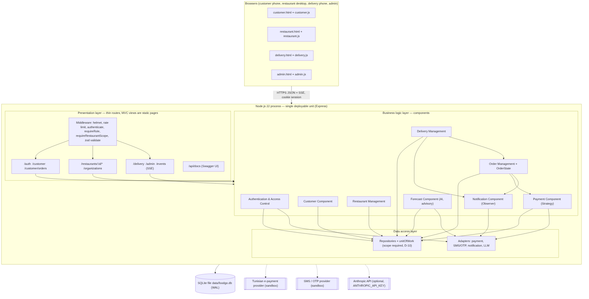

# Developer guide

## Architecture

FoodGO follows the Lab 4 SDD: a layered, single deployable Node.js process.



| Layer | Folder | Rule |
|---|---|---|
| Presentation | `src/api` (routes, middleware, schemas), `src/public` (static UI) | Validate input, check role and restaurant scope, call **one** component, shape the response. No business rule. |
| Business logic | `src/components` | One component per specification module. Only `orderManagement` creates orders or changes their status. |
| Domain | `src/domain` | Pure functions and value rules: deadline, money, order state machine, forecast model, error codes. |
| Data access | `src/repositories`, `src/adapters` | Only repositories issue SQL; restaurant-owned queries require the scope argument. Third-party contracts only through adapters. |
| Composition | `src/context.js`, `src/app.js`, `src/server.js` | Wiring. Tests build the same context with an in-memory DB and a fixed clock. |

### Design patterns (SDD §7.1)

| Pattern | Where | Why |
|---|---|---|
| State | `src/domain/orderState.js` | Illegal status transitions are impossible; guards encode BR-10 and BR-11 |
| Strategy | `src/components/paymentComponent.js` | Payment methods vary per restaurant; adding one does not touch ordering |
| Adapter | `src/adapters/*` | Payment provider, SMS, notifications and LLM are unresolved or optional |
| Observer | `src/components/notificationComponent.js` | One status change reaches customer, restaurant and courier, filtered by BR-15, after commit |
| Repository + Unit of Work | `src/repositories` | Transactions T1–T3 are all-or-nothing |

### Request lifecycle

`helmet → JSON body → cookie → authenticate (session lookup) → requireRole → requireRestaurantScope → validate (zod) → component → repositories (transaction) → response → events published after commit`.

### Data

SQLite file at `data/foodgo.db` (WAL mode). Schema in `src/db/schema.sql`, incremental changes in `src/db/migrations/NNN_name.sql` (applied once, in order, at start-up). Money is stored as integer **millimes** (1 TND = 1000). Times are ISO-8601 UTC; the ordering deadline is a local `HH:MM` evaluated in `TZ` (default `Africa/Tunis`).

## Setup

```bash
git clone https://github.com/HamzaBL04/foodGO.git
cd foodGO
npm install
npm run dev          # restarts on file changes, http://localhost:3000
```

Configuration (environment variables, all optional):

| Variable | Default | Meaning |
|---|---|---|
| `PORT` | `3000` | HTTP port |
| `FOODGO_DB` | `data/foodgo.db` | SQLite file |
| `TZ` | `Africa/Tunis` | Time zone of the ordering deadline |
| `FOODGO_DEMO_MODE` | `true`, but `false` when `NODE_ENV=production` | Show the SMS code on screen (no real SMS provider yet) |
| `ANTHROPIC_API_KEY` | empty | Enables the Claude-written forecast note |
| `ANTHROPIC_MODEL` | `claude-haiku-5-5` | Model for that note |
| `NODE_ENV` | `development` | `production` makes the session cookie `Secure` |

`npm run seed` deletes and recreates the demo database.

## Code style

See [STYLE_GUIDE.md](STYLE_GUIDE.md). Enforced by `npm run lint` (ESLint flat config, `eslint.config.js`) and `.editorconfig`.

## Tests

```bash
npm test             # all tests
npm run coverage     # all server code (src/, excluding the browser files in src/public), 60 % gate used by CI
```

- `test/unit`: pure domain logic (deadline, state machine, strategies, forecast model, adapters).
- `test/integration`: the HTTP API over an in-memory database (`test/helpers.js` → `createTestApp`). Includes the full end-to-end scenario from spec §16.3 and a live SSE test.
- Tests use a fixed clock: Monday 2 Nov 2026 08:00 Tunis time unless a test sets another.

`npm run traceability` regenerates `docs/requirements/TRACEABILITY.md` from the requirement IDs cited in code and test titles. Cite the IDs you implement.

## Contributing

1. Create a branch `feat/<short-name>`, `fix/<name>`, `docs/<name>` or `refactor/<name>` from `main`.
2. Commit with conventional prefixes (`feat:`, `fix:`, `test:`, `docs:`, `refactor:`, `ci:`). Disclose AI assistance with a `Co-Authored-By:` trailer.
3. Add tests with every change. Keep `npm run lint` clean.
4. Open a pull request with: what, requirement IDs, tests, AI disclosure.
5. Merge when CI is green.

## CI

`.github/workflows/ci.yml` runs on every push to `main` and every pull request, on Node 22 and 24: `npm ci` → `npm run lint` → `npm run coverage` (fails below 60 % lines). The coverage report is uploaded as a build artifact.

## Deployment

Any host that runs Node.js 22.14+ with a persistent disk works (a small VM, Render, Railway, Fly.io):

```bash
NODE_ENV=production FOODGO_DEMO_MODE=false PORT=8080 FOODGO_DB=/var/lib/foodgo/foodgo.db npm start
```

Put it behind HTTPS (reverse proxy or the platform's TLS). Back up the SQLite file daily. A real SMS provider must be added (one adapter) before turning demo mode off, otherwise customers cannot receive their code.

## API

OpenAPI 3 description: [docs/api/openapi.yaml](api/openapi.yaml). Interactive documentation is served at `/api/docs` when the app runs.
