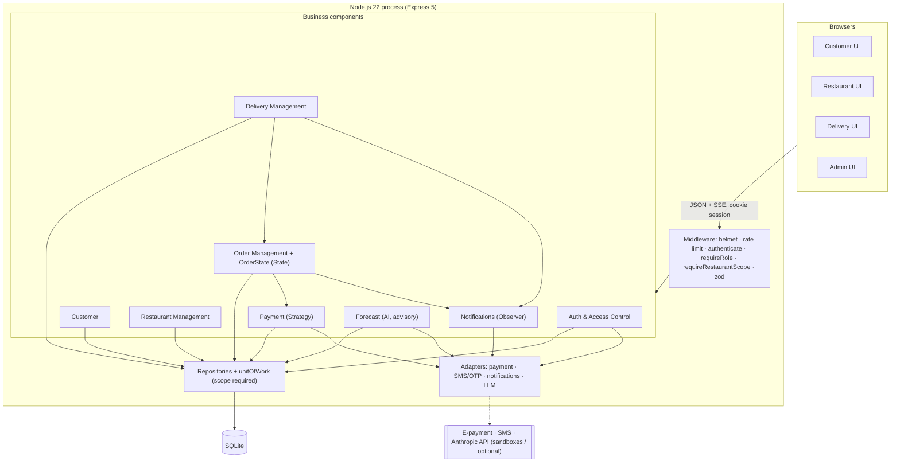
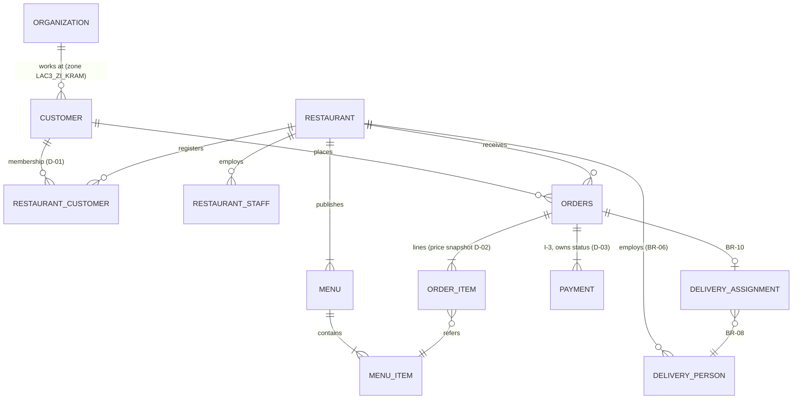

# Architecture

Living summary of the Lab 4 Software Design Document ([full SDD](lab4-sdd/FoodGO_Software_Design_Document.pdf)) as it is actually built. When code and this page disagree, fix one of them in the same PR. Decisions behind it: [decisions/](decisions/).

## 1. Overview

FoodGO is a **layered, single-process web application** (SDD §2.1: layered architecture as the primary style, client–server for communication, MVC only in the presentation layer, events only for notification fan-out). Browsers load four static UIs (customer, restaurant, delivery, admin) that call a REST JSON API and listen to a Server-Sent Events stream. The API runs in one Node.js 22 process: middleware authenticates and scopes every request, business components apply the rules, and repositories persist to a local SQLite file. Third-party services (Tunisian e-payment, SMS/OTP, notifications, an optional LLM) sit behind adapters; today they are sandboxes because no provider has been selected (Q-22).

FoodGO serves one area only, **Lac 3 / Zone Industrielle Le Kram** (FR-32, BR-17, [ADR-0007](decisions/0007-service-area-lac3-zi-kram.md)): restaurants and workplaces each carry its zone (`LAC3_ZI_KRAM`), and Order Management refuses an order unless both are inside the area (`src/domain/serviceArea.js`).

The rule that shapes everything: **the platform coordinates, the restaurant delivers.** No component employs, schedules or equips a delivery person (BR-06, BR-07), and every restaurant-owned query carries the restaurant scope (BR-09, D-10).

## 2. Component diagram

Full UML set (use-case, class, three sequence diagrams, component/deployment) with Mermaid sources: [uml/](uml/README.md).

## 3. Key modules

| Module | Responsibility | Lives in |
|--------|----------------|----------|
| Presentation | Routes per interface, validation, role and scope checks, static UIs | `src/api/`, `src/public/` |
| Auth & Access Control | Password sign-in (staff, delivery, admin), SMS one-time code (customers), sessions, staff provisioning (FR-29) | `src/components/auth.js` |
| Customer | My restaurants, menus, profile; membership check (BR-04, BR-16) | `src/components/customerComponent.js` |
| Restaurant Management | Menu and availability, deadline and payment settings, in-person registration, eligibility, delivery team (FR-01–FR-08, FR-16–FR-18, FR-30) | `src/components/restaurantManagement.js` |
| Order Management | Submission transaction T1, queue, status changes through the State pattern (FR-09–FR-15, BR-01, BR-02, BR-14) | `src/components/orderManagement.js`, `src/domain/orderState.js` |
| Delivery Management | Assignment T2, scoped assignment list, start, confirmation T3 (FR-19–FR-23, BR-08, BR-10, BR-11) | `src/components/deliveryManagement.js` |
| Payment | Strategy per method; Payment owns the status, the order holds a projection (FR-25–FR-28, D-03) | `src/components/paymentComponent.js` |
| Notifications | Event bus, events after commit (D-08), BR-15 visibility for the live stream | `src/components/notificationComponent.js` |
| Forecast | Demand forecast, backtest, optional LLM note (FR-31) | `src/components/forecastComponent.js`, `src/domain/forecast.js` |
| Data access | SQL, scope enforcement, transactions | `src/repositories/`, `src/db/` |
| Adapters | Protocol translation to third parties only | `src/adapters/` |

## 4. Data model

Twelve SDD classes, one table each (SDD §4.1), plus platform tables (`session`, `otp_challenge`, `audit_event`, `platform_admin`).

Money is integer millimes; `orders.deadline_snapshot` freezes the deadline in force (D-04); migrations live in `src/db/migrations/` (001 idempotency key, 002 indexes, 003 `service_zone` on `organization` and `restaurant`, FR-32).

## 5. Key flows

- **UC-01 Place a morning pre-order** — one transaction (T1): membership → service area (BR-17, ORDER-003) → deadline gate (BR-01, ORDER-001) → availability (BR-02, ORDER-002) → order + items + payment row + deadline snapshot → commit → `OrderSubmitted` / `OrderConfirmed` events. A declined e-payment rolls the whole order back (PAY-001). [Sequence diagram](uml/sequence-uc01-place-order.png)
- **UC-02 Assign and deliver** — T2 checks the courier belongs to the order's restaurant and stores the assignment before dispatch; T3 lets only the assignee confirm, completes the assignment, moves the order to DELIVERED and records cash. [Sequence diagram](uml/sequence-uc02-assign-deliver.png)
- **UC-03 Payment status** — Strategy resolved at runtime; provider reached only through the adapter. [Sequence diagram](uml/sequence-uc03-payment.png)

## 6. The AI-assisted component

The restaurant **Prep forecast** (FR-31, added when the team withdrew assumption A-13; see [ADR-0004](decisions/0004-advisory-ai-demand-forecast.md)).

- **In:** quantities sold per dish per service day for the last 35 days (aggregates only, no customer data).
- **Model:** same-weekday weighted average over 4 weeks (40/30/20/10 %), blended 60/40 with the last 7 service days; range = ± spread; confidence from sample count; weekdays with no recent service skipped. A 7-day backtest reports its own mean absolute error.
- **LLM (optional):** if `ANTHROPIC_API_KEY` is set, the LLM adapter asks Claude (`claude-haiku-5-5` by default) for ≤ 3 sentences of prep advice using only those numbers.
- **Out:** expected quantity, range and confidence per dish, a summary, and the accuracy figure, labelled as advice.
- **If it fails or is unavailable:** a template summary is used (timeouts and errors are logged); the forecast never blocks ordering, and nothing else depends on it. Every view is audited with its summary source.

## 7. Known trade-offs / open questions

- **Failure lifecycle is UNRESOLVED** (cancellation, restaurant rejection, failed delivery, refunds): not built; `OrderState` is the single extension point.
- **Sandbox providers:** no real Tunisian payment or SMS provider yet (Q-22); demo mode shows the SMS code and is off by default in production.
- **Delivery location** is the customer's registered organization and its zone (PROPOSED; Q-02).
- **Service area open points** (ADR-0007): restaurants outside the area cannot join for now; staggered delivery windows and a traffic measure are not decided.
- **Single process + SQLite** is deliberate for this scale (ADR-0002); revisit conditions are in SDD §2.1.4.
- **Cash not collected** at confirmation leaves the payment PENDING; what happens next is a stakeholder decision.
- **No deployment yet;** availability targets cannot be measured until there is one.
