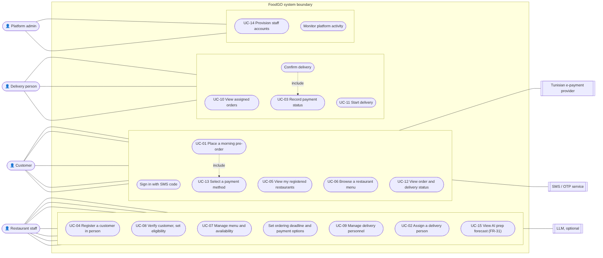

# FoodGO — Software Requirements Specification

**Course:** CS 488 AI-First Software Engineering, Fall 2026 · **Lab 2 deliverable** (template: IEEE 830 / ISO/IEC/IEEE 29148)
**Team:** Hamza Ben Labiedh, Ali Chamakh, Mohamed Krid · **Version:** 1.0, 1 Nov 2026 · **Repository:** https://github.com/HamzaBL04/foodGO

> **How to read this document.** Requirements keep the identifiers of our earlier specification (FR-01–FR-30, BR-01–BR-16) so that every trace still works. Requirements added later by team decision are FR-31, FR-32, BR-17, BR-18 and NFR-13–NFR-15. Each requirement carries a status: *Validated* (from our validated elicitation document), *Team decision* (recorded in an ADR), *Proposed* (a position taken to make the system buildable, still to be validated with stakeholders) or *Unresolved* (a business decision not yet made, which must not be invented).
>
> This file is generated by `docs/lab2-srs/build_srs.py`. Sections 4–5 come from `docs/lab3-practical/SRS_SKELETON.md`; the use cases, elicitation log, analysis table and review log come from the Lab 3 worksheet; the test column of Section 6 comes from the test suite. Edit those sources, not this file.

---

## 1. Introduction

### 1.1 Purpose

This document specifies what FoodGO must do and how well it must do it. It is written for the three team members who build and test FoodGO, for the course instructor who evaluates it, and for anyone who maintains it later. It is the reference for design (Lab 4 SDD), for implementation, and for the tests listed in Section 6.

### 1.2 Scope

FoodGO is a **pre-order lunch platform for one area of Tunis: Lac 3 / Zone Industrielle Le Kram** (one area, known by both names).

**The problem.** Traffic in the area gets heavy at lunchtime because many employees leave their workplace at the same moment to get food. Restaurants are then swamped by everyone arriving at once and cook without knowing how much they will sell.

**The product.** An employee orders lunch in the morning, before a deadline set by the restaurant. At the deadline the restaurant knows exactly what to cook, and its own delivery staff bring the food to the employee's workplace at noon. Employees stay at their desks; many individual lunch trips become a few planned delivery runs. **The platform coordinates; the restaurant delivers.**

**Benefits and goals:** less lunchtime traffic in the area (team goal, ADR-0007); shorter lunch-hour waiting and ordering moved before lunch (BG-01, BG-02); better preparation planning (BG-03, BG-04); organised delivery (BG-05); convenient payment (BG-06); restaurants control who they serve (BG-07); accurate, visible orders (BG-08, BG-09).

**In scope:** in-person customer registration and SMS-code sign-in; menus and availability; morning pre-orders with a restaurant deadline; customer verification; the restaurant's own delivery team (assignment, start, confirmation); cash on delivery and Tunisian e-payment status; account provisioning; administrator monitoring; an advisory prep forecast; the service-area rules.

**Out of scope (this release):** other areas of Tunis; customer self-registration; order cancellation, restaurant rejection, failed delivery, refunds; delivery fees; GPS tracking; a platform-employed delivery fleet; a named real payment provider; staggered delivery windows.

### 1.3 Definitions, acronyms, abbreviations

The key terms are below; the full glossary is Appendix 7.3.

| Term | Meaning |
|---|---|
| Customer | An employee or student whose workplace is in the service area |
| Customer account | The access a restaurant creates for a customer in person |
| Workplace | The office, factory, school or institution a customer belongs to |
| Service area | Lac 3 / Zone Industrielle Le Kram |
| Delivery person | A person employed and equipped by a restaurant to deliver its orders |
| Ordering deadline | The restaurant's daily cut-off time for that day's orders |
| FR / NFR / BR | Functional requirement / non-functional requirement / business rule |
| UC | Use case |
| BG | Business goal (BG-01–BG-09) |
| ADR | Architecture Decision Record (`docs/decisions/`) |
| OTP | One-time password, sent by SMS to sign in |
| MoSCoW | Must / Should / Could / Won't priority scale |
| TND, millime | Tunisian dinar; 1 TND = 1,000 millimes |

### 1.4 References

| Reference | Used for |
|---|---|
| FoodGO Software Specification (`docs/lab3-specification/`) | The validated requirements FR-01–FR-30, BR-01–BR-16, quality attributes, 36 unresolved items |
| Lab 3 practical worksheet (`docs/lab3-practical/`) | Stakeholders, elicitation, analysis table, use cases, peer review |
| Lab 4 Software Design Document (`docs/lab4-sdd/`) | Use-case register (Appendix A), design decisions |
| ADR-0004 (AI forecast), ADR-0007 (service area) | Requirements added after the specification |
| Product backlog (`docs/requirements/BACKLOG.md`) | User stories and MoSCoW priorities |
| Traceability matrix (`docs/requirements/TRACEABILITY.md`) | Requirement → code → test, generated from the repository |
| CS 488 Lab 2 brief | SRS structure and the validation checklist |

### 1.5 Overview of the document

Section 2 describes the product's context, users and constraints. Section 3 shows the use cases. Sections 4 and 5 are the functional and non-functional requirements. Section 6 traces every requirement to its source, use case and test, and records the validation. Section 7 holds the elicitation log, the requirements analysis table and the glossary.

---

## 2. Overall Description

### 2.1 Product perspective

FoodGO is a new, self-contained web application. Today, employees in the area walk or drive to restaurants at noon, or phone them, and restaurants learn their demand only when customers arrive. FoodGO replaces that with morning ordering.

It sits between three parties and a few external services:

- **Customers** use a phone-sized web interface to order and follow their orders.
- **Restaurants** use a desktop interface to manage menus, register customers, see orders and assign their own delivery persons.
- **Delivery persons** use a phone-sized interface to see and complete their assignments.
- **The platform administrator** creates restaurants and staff accounts and monitors activity.
- **External services:** a Tunisian e-payment provider, an SMS/OTP service, a notification channel, and (optionally) an LLM for the forecast note. None is selected yet; each is reached through a replaceable adapter.

Preparing food, transporting it and employing or equipping delivery persons stay outside the system (BR-06, BR-07).

### 2.2 Product functions

- Register a customer in person and let them sign in with an SMS code
- Show each customer only the restaurants that registered them, with menus and availability
- Take pre-orders before the restaurant's deadline and refuse them after it
- Keep every restaurant and workplace inside the service area
- Show restaurants their orders live, with the information needed to verify the customer
- Let restaurants assign orders to their own delivery persons, who start and confirm deliveries
- Record the payment method and status (cash on delivery or e-payment)
- Show customers the live status of their orders
- Give restaurants an advisory forecast of the next service's dishes
- Let the administrator provision restaurants and staff and monitor activity

### 2.3 User classes and characteristics

| User class | Characteristics | Frequency | Priority |
|---|---|---|---|
| Customer (employee or student in the area) | Uses a phone; little time in the morning; may have no prior experience of food apps; Arabic, French or English speaking | Daily, a few minutes | Primary |
| Restaurant staff | Uses a desktop or tablet at the counter; busy at noon; registers customers face to face | Throughout the day | Primary |
| Delivery person | Uses a phone while moving; needs large, simple controls and the cash amount up front | During lunch deliveries | Primary |
| Platform administrator | Technical; sets up restaurants and accounts; reads monitoring | Occasional | Secondary |

### 2.4 Operating environment

- **Clients:** current mobile and desktop browsers (see NFR-14). No app installation.
- **Server:** one Node.js process with a local SQLite database, on any machine that can run Node.js 22 or later.
- **Time zone:** Africa/Tunis; ordering deadlines are local times.
- **Network:** internet access between clients and server; the external services are optional during development (sandboxes).

### 2.5 Design and implementation constraints

- The platform coordinates and never employs, schedules or equips delivery persons (BR-06, BR-07).
- Every restaurant's data is visible only to that restaurant (BR-09); customer data only to authorised parties (BR-15).
- Customer accounts are created only by restaurants, in person (BR-05, BR-16).
- FoodGO operates only in the service area; restaurants outside it cannot join (BR-17, BR-18).
- External providers must be replaceable without changing business rules, because none is selected yet (NFR-10).
- Business decisions marked Unresolved in the specification must not be invented in the implementation.

### 2.6 Assumptions and dependencies

- The specification's assumptions A-01–A-15 hold, **except A-13** ("AI is out of scope"), which the team withdrew on 1 Nov 2026 for an advisory forecast only (ADR-0004, Proposed).
- Restaurants in the area are willing to deliver with their own staff (A-04–A-07).
- **Dependencies:** an SMS/OTP provider and a Tunisian e-payment provider must be chosen before production (open question Q-22); the service window used for availability (NFR-11) and the compliance obligations (NFR-15) are business decisions still to be made.
- The lunchtime-traffic problem is assumed from the team's knowledge of the area; it will be confirmed by interviews in Sprint 2.

---

## 3. System Features / Use Cases

### 3.1 Use case diagram

**Actors:** Customer, Restaurant staff, Delivery person, Platform administrator; external systems: Tunisian e-payment provider, SMS/OTP service, LLM (optional).

**Use-case register** (derived in the Lab 4 SDD, Appendix A; UC-15 added with FR-31):

| UC | Name | Primary actor | Requirements |
|---|---|---|---|
| UC-01 | Place a morning pre-order | Customer | FR-09–FR-15, FR-32, BR-01, BR-17 |
| UC-02 | Assign a delivery person and complete delivery | Restaurant staff, Delivery person | FR-19–FR-23 |
| UC-03 | Record payment status | Delivery person (system) | FR-25–FR-28 |
| UC-04 | Register a customer in person | Restaurant staff | FR-01–FR-04, FR-32 |
| UC-05 | View the restaurants that registered me | Customer | FR-05 |
| UC-06 | Browse a restaurant menu | Customer | FR-06 |
| UC-07 | Manage menus and item availability | Restaurant staff | FR-07, FR-08 |
| UC-08 | Verify a customer and record eligibility | Restaurant staff | FR-16, FR-17 |
| UC-09 | Manage the restaurant's delivery persons | Restaurant staff | FR-18 |
| UC-10 | View assigned orders and delivery information | Delivery person | FR-20, FR-21 |
| UC-11 | Update delivery status | Delivery person | FR-22 |
| UC-12 | View order and delivery status | Customer | FR-24 |
| UC-13 | Select a payment method | Customer | FR-25, FR-26 |
| UC-14 | Provision staff and delivery accounts | Administrator, Restaurant staff | FR-29, FR-30 |
| UC-15 | View the AI prep forecast | Restaurant staff | FR-31 |

### 3.2 Detailed use case descriptions

#### Use case UC-01 — Place a morning pre-order

- **Use Case ID:** UC-01
- **Name:** Place a morning pre-order
- **Actor:** Customer (an employee registered by the restaurant)
- **Preconditions:** The customer is signed in; a restaurant registered them and they are eligible; the restaurant and the customer's workplace are in Lac 3 / Zone Industrielle Le Kram; it is before the restaurant's ordering deadline.
- **Main flow:**
  1. The customer opens one of their restaurants and sees today's menu and the time left before the deadline.
  2. The customer chooses available dishes and quantities; the system shows the exact total.
  3. The customer chooses cash on delivery or e-payment (only methods the restaurant enabled).
  4. The customer submits the order.
  5. The system checks registration, service area, deadline, availability and payment method, saves the order, and shows an order number FG-XXXXXX.
  6. The restaurant sees the new order in its queue immediately.
- **Alternate flow:** 5a. The deadline has passed → the order is refused ("Ordering for today closed at HH:MM", ORDER-001). 5b. A dish became unavailable → refused (ORDER-002). 5c. The restaurant or workplace is outside the service area → refused (ORDER-003). 5d. E-payment is declined → no order is created (PAY-001). 4a. The customer's connection drops and the app retries → the same order is returned, not a second one.
- **Postconditions:** One order with its items, total, payment record and deadline snapshot exists, visible to this customer and this restaurant only.
- **Linked requirements:** FR-05, FR-06, FR-09–FR-15, FR-25, FR-26, FR-32; BR-01, BR-02, BR-04, BR-12, BR-16, BR-17; NFR-01, NFR-04

#### Use case UC-04 — Register a customer in person

- **Use Case ID:** UC-04
- **Name:** Register a customer in person
- **Actor:** Restaurant staff
- **Preconditions:** The staff member is signed in to their own restaurant; the customer is present with an ID.
- **Main flow:**
  1. The staff member opens Customers and enters the customer's full name and phone number.
  2. The staff member picks the customer's workplace (each workplace is in the service area).
  3. The staff member checks the customer's identity and ticks "I checked their identity in person".
  4. The system creates the customer (or reuses the existing person with that phone number) and adds a membership for this restaurant.
  5. The customer can now sign in with an SMS code and sees this restaurant.
- **Alternate flow:** 2a. The workplace is missing → the staff member adds it with its zone; a place outside the area is refused (VAL-001). 3a. Identity not confirmed → registration refused (BR-05). 4a. The customer is already registered at this restaurant → refused as a duplicate.
- **Postconditions:** One canonical customer record and one active, eligible membership for this restaurant; nothing visible to other restaurants.
- **Linked requirements:** FR-01–FR-04, FR-16, FR-17, FR-32; BR-04, BR-05, BR-15, BR-16

---

## 4. Functional Requirements

Grouped by area. Identifiers follow the specification; FR-31, FR-32, BR-17 and BR-18 were added by team decision.

### 4.1 Accounts and access

| ID | Requirement | Priority | Status |
|---|---|---|---|
| FR-01 | The system shall allow authorized restaurant staff to create a customer account, valid only for their own restaurant. The system shall not offer customer self-registration. | Must | Validated |
| FR-02 | The system shall store the customer's full name and show it only to authorized parties. | Must | Validated |
| FR-03 | The system shall store the customer's phone number and reject a number that is not in the form +216 followed by 8 digits. | Must | Validated |
| FR-04 | The system shall store the customer's workplace. | Must | Validated |
| FR-29 | The system shall allow the platform administrator to create restaurant staff accounts, each bound to exactly one restaurant. | Must | Validated |
| FR-30 | The system shall allow a restaurant to create accounts for its own delivery persons, visible to no other restaurant. | Must | Validated |

### 4.2 Service area

| ID | Requirement | Priority | Status |
|---|---|---|---|
| FR-32 | The system shall record, for every restaurant and every workplace, that it is located in the service area, and shall refuse to create a restaurant or workplace located anywhere else. | Must | Team decision (ADR-0007) |

### 4.3 Restaurants and menus

| ID | Requirement | Priority | Status |
|---|---|---|---|
| FR-05 | The system shall show a customer only the restaurants that created their account and still consider them eligible. | Must | Validated |
| FR-06 | The system shall show a customer the menu of each of those restaurants, including dishes that are currently unavailable, marked as such. | Must | Validated |
| FR-07 | The system shall allow authorized staff of a restaurant to create, edit and remove that restaurant's menu items (name, description, price). | Must | Validated |
| FR-08 | The system shall allow authorized restaurant staff to mark a menu item available or unavailable; an unavailable item cannot be ordered. | Must | Validated |

### 4.4 Ordering

| ID | Requirement | Priority | Status |
|---|---|---|---|
| FR-09 | The system shall allow a customer to add available menu items to an order. | Must | Validated |
| FR-10 | The system shall allow a customer to set a quantity from 1 to 50 for each item. | Must | Validated |
| FR-11 | The system shall calculate the order total as the sum of quantity × unit price over all items, exact to the millime. | Must | Validated |
| FR-12 | The system shall accept an order only if it is submitted strictly before its restaurant's ordering deadline for that day. | Must | Validated |
| FR-13 | The system shall reject an order submitted at or after the deadline and tell the customer the deadline time. | Must | Validated |
| FR-14 | The system shall confirm each accepted order with a unique identifier, and a retried submission shall return the same order rather than create a second one. | Must | Validated |
| FR-15 | The system shall make an accepted order visible to its restaurant, and to no other restaurant, as soon as it is accepted. | Must | Validated |

### 4.5 Customer verification

| ID | Requirement | Priority | Status |
|---|---|---|---|
| FR-16 | The system shall show authorized staff of a restaurant the name, phone number and workplace of the customers registered at that restaurant. | Must | Validated |
| FR-17 | The system shall allow authorized restaurant staff to mark a customer ineligible; an ineligible customer shall neither see nor order from that restaurant. | Must | Validated |

### 4.6 Delivery

| ID | Requirement | Priority | Status |
|---|---|---|---|
| FR-18 | The system shall allow a restaurant to create and list its own delivery persons. Deactivation and other management details remain unresolved (spec item 12). | Must | Validated |
| FR-19 | The system shall allow authorized restaurant staff to assign an order to one of that restaurant's active delivery persons. | Must | Validated |
| FR-20 | The system shall show a delivery person only the orders assigned to them. | Must | Validated |
| FR-21 | The system shall give the delivery person, for each assigned order, the pickup restaurant, the customer's name, phone and workplace, the items, and the cash amount to collect. | Must | Validated |
| FR-22 | The system shall allow the assigned delivery person to mark a delivery as started. | Must | Validated (states Proposed) |
| FR-23 | The system shall allow only the assigned delivery person to confirm a started delivery, recording the confirmation against that order. | Must | Validated |
| FR-24 | The system shall show a customer the current status of their own orders, updated without reloading the page. | Should | Validated |

### 4.7 Payment

| ID | Requirement | Priority | Status |
|---|---|---|---|
| FR-25 | The system shall allow a customer to choose only among the payment methods the restaurant has enabled. | Must | Validated |
| FR-26 | When a restaurant enables cash on delivery, the system shall record the payment as pending at ordering and as paid when the delivery person confirms the cash was collected. | Must | Validated |
| FR-27 | When an approved Tunisian e-payment provider is integrated, the system shall take payment through it at ordering and shall not create the order if the payment is declined. | Should | Validated (provider unresolved) |
| FR-28 | The system shall record each order's payment method and payment status. | Must | Validated |

### 4.8 Planning support

| ID | Requirement | Priority | Status |
|---|---|---|---|
| FR-31 | The system shall show authorized restaurant staff a next-service quantity forecast and range per menu item, computed only from aggregated order counts. The forecast shall not create, change, accept or reject any order, payment, eligibility or menu record. | Should | **Proposed** (ADR-0004; stakeholder validation pending) |

### 4.9 Business rules added after the specification

| ID | Rule | Status |
|---|---|---|
| BR-17 | An order shall be accepted only if both the restaurant and the customer's workplace are located in the service area. | Team decision (ADR-0007) |
| BR-18 | A restaurant located outside the service area cannot join FoodGO, even to deliver into it. | Team decision (ADR-0007) |

BR-01–BR-16 are unchanged (spec Appendix A5).

---

---

## 5. Non-Functional Requirements

Targets are the specification's Proposed targets unless stated otherwise.

### 5.1 Performance

| ID | Category | Requirement | Priority | How it is checked |
|---|---|---|---|---|
| NFR-01 | Performance | With 300 orders already placed for the day at one restaurant, 95 % of requests shall complete within 500 ms and 99 % within 1.5 s; order submission within 2 s, excluding the payment provider. | Must | `npm run benchmark` |

### 5.2 Security

| ID | Category | Requirement | Priority | How it is checked |
|---|---|---|---|---|
| NFR-02 | Security | The system shall authenticate every user, allow each role only its own functions, limit restaurant staff and delivery persons to their own restaurant's data, store credentials only as salted hashes, and slow down repeated failed sign-ins. | Must | Integration tests |
| NFR-03 | Privacy | Customer data shall be visible only to authorized parties (BR-15), and no customer data shall be sent to the LLM. | Must | Scope tests, prompt test |

### 5.3 Usability

| ID | Category | Requirement | Priority | How it is checked |
|---|---|---|---|---|
| NFR-07 | Usability | A customer shall be able to place an order in at most 4 screens, and shall see the ordering deadline before ordering. | Should | UI review |
| NFR-08 | Accessibility | The user interface shall meet WCAG 2.2 level AA. | Should | Audit (planned) |

### 5.4 Reliability

| ID | Category | Requirement | Priority | How it is checked |
|---|---|---|---|---|
| NFR-04 | Reliability | The system shall never lose, duplicate or half-save an order. | Must | Transaction and retry tests |
| NFR-11 | Availability | The system shall be available 99.5 % of each month during the service window. **The service window is still a business decision**, so this target cannot be tested yet. | Should | After deployment |

### 5.5 Other quality attributes

| ID | Category | Requirement | Priority | How it is checked |
|---|---|---|---|---|
| NFR-05 | Maintainability | Business rules shall be separated from the user interface and from data storage, and no function shall exceed a cyclomatic complexity of 10. | Should | Lint in CI |
| NFR-06 | Testability | Each feature shall have automated tests, with at least 60 % line coverage of server code. | Must | Coverage in CI |
| NFR-09 | Observability | Every security-relevant action (sign-in, provisioning, order, assignment, delivery, payment) shall be recorded in an audit log, and the service shall expose a health check. | Should | Admin monitor |
| NFR-10 | Interoperability | Each external provider (payment, SMS/OTP, notification, LLM) shall be replaceable without changing business rules. | Should | Adapter tests |
| NFR-12 | Portability | The system shall install and run on a fresh machine with a single install command and no external service. | Could | Fresh-clone check |
| NFR-13 | Scalability | **Proposed:** The system shall handle the morning ordering peak of the whole service area. Target numbers (restaurants, customers, orders per peak) are set after the Sprint 2 interviews. Serving another area requires a new ADR. | Should | Benchmark at the agreed numbers |
| NFR-14 | Compatibility | The customer and delivery interfaces shall work on the current versions of Chrome, Safari and Firefox on phones, and the restaurant and admin interfaces on the same browsers on desktop. | Should | Manual check per release |
| NFR-15 | Legal / compliance | The personal-data and e-payment obligations that apply in Tunisia shall be identified and met before production use. **Unresolved** (spec §7.11): which obligations apply is not yet decided. | Must (before production) | Compliance review |

---

## 6. Requirements Traceability Matrix

### 6.1 Matrix

Source = where the requirement came from; Use case = Section 3; Test case = an automated test in the repository that checks it (from `docs/requirements/TRACEABILITY.md`; full lists there).

| Requirement ID | Source (stakeholder / interview) | Use case | Test case |
|---|---|---|---|
| FR-01 | Elicitation document (restaurant manager, customer) | UC-04 | UC-04 / FR-01–FR-04: in-person registration creates a person and a membership, then OTP sign-in works |
| FR-02 | Elicitation document | UC-04 | UC-04 / FR-01–FR-04: in-person registration creates a person and a membership, then OTP sign-in works |
| FR-03 | Elicitation document | UC-04 | UC-04 / FR-01–FR-04: in-person registration creates a person and a membership, then OTP sign-in works |
| FR-04 | Elicitation document | UC-04 | UC-04 / FR-01–FR-04: in-person registration creates a person and a membership, then OTP sign-in works |
| FR-05 | Elicitation document (customer) | UC-05 | FR-05: customer profile and restaurant list carry deadline information |
| FR-06 | Elicitation document | UC-06 | FR-08 / FR-06: availability toggle is visible to the customer |
| FR-07 | Elicitation document | UC-07 | FR-07 / BR-03: staff add, edit and soft-remove menu items |
| FR-08 | Elicitation document | UC-07 | FR-08 / FR-06: availability toggle is visible to the customer |
| FR-09 | Elicitation document | UC-01 | UC-01 / FR-09–FR-11, FR-14: a customer places a cash pre-order; total and confirmation are correct |
| FR-10 | Elicitation document | UC-01 | UC-01 / FR-09–FR-11, FR-14: a customer places a cash pre-order; total and confirmation are correct |
| FR-11 | Elicitation document | UC-01 | UC-01 / FR-09–FR-11, FR-14: a customer places a cash pre-order; total and confirmation are correct |
| FR-12 | Elicitation document (restaurant owner) | UC-01 | BR-01 / FR-12 / FR-13: orders before the deadline are accepted, after it refused with ORDER-001 |
| FR-13 | Elicitation document (restaurant owner) | UC-01 | BR-01 / FR-12 / FR-13: orders before the deadline are accepted, after it refused with ORDER-001 |
| FR-14 | Elicitation document | UC-01 | UC-01 / FR-09–FR-11, FR-14: a customer places a cash pre-order; total and confirmation are correct |
| FR-15 | Elicitation document | UC-01 | FR-15 / BR-09: the order appears in its restaurant queue only |
| FR-16 | Elicitation document | UC-08 | BR-15 / FR-16: staff see verification info only for their own customers |
| FR-17 | Elicitation document | UC-08 | ineligible memberships are not listed (FR-17) |
| FR-18 | Elicitation document | UC-09 | FR-18 / FR-30: staff provision their own delivery personnel |
| FR-19 | Elicitation document (restaurant staff) | UC-02 | System scenario (spec §16.3, FR-19–FR-24): order -> prepare -> assign -> deliver -> cash recorded |
| FR-20 | Elicitation document | UC-10 | System scenario (spec §16.3, FR-19–FR-24): order -> prepare -> assign -> deliver -> cash recorded |
| FR-21 | Elicitation document (delivery person); MVP walkthrough | UC-10 | System scenario (spec §16.3, FR-19–FR-24): order -> prepare -> assign -> deliver -> cash recorded |
| FR-22 | Elicitation document | UC-11 | System scenario (spec §16.3, FR-19–FR-24): order -> prepare -> assign -> deliver -> cash recorded |
| FR-23 | Elicitation document | UC-02 | System scenario (spec §16.3, FR-19–FR-24): order -> prepare -> assign -> deliver -> cash recorded |
| FR-24 | Elicitation document (customer); MVP walkthrough | UC-12 | System scenario (spec §16.3, FR-19–FR-24): order -> prepare -> assign -> deliver -> cash recorded |
| FR-25 | Elicitation document | UC-13 | FR-25, FR-27, FR-28, BR-13: e-payment is captured at checkout and projected onto the order (D-03) |
| FR-26 | Elicitation document | UC-13, UC-03 | FR-26: a disabled payment method is refused |
| FR-27 | Elicitation document (payment provider) | UC-03 | FR-25, FR-27, FR-28, BR-13: e-payment is captured at checkout and projected onto the order (D-03) |
| FR-28 | Elicitation document | UC-03 | BR-12 / FR-28 / I-3: every order has a payment row created with it |
| FR-29 | Elicitation document (platform administrator) | UC-14 | FR-29: admin creates a restaurant and provisions its staff, who can then sign in |
| FR-30 | Elicitation document | UC-14 | FR-18 / FR-30: staff provision their own delivery personnel |
| FR-31 | Team decision, ADR-0004 (restaurant staff) | UC-15 | FR-31: staff get a forecast built from order history, with a template summary by default |
| FR-32 | Product-owner interview 1 Nov, ADR-0007 | UC-01, UC-04 | FR-32, BR-18: a restaurant cannot be created without a zone, or outside the service area |
| BR-01 | Elicitation document | UC-01 | BR-01 / FR-12 / FR-13: orders before the deadline are accepted, after it refused with ORDER-001 |
| BR-02 | Elicitation document | UC-01 | BR-02: an unavailable item cannot be ordered (ORDER-002) |
| BR-03 | Elicitation document | UC-07 | FR-07 / BR-03: staff add, edit and soft-remove menu items |
| BR-04 | Elicitation document | UC-05, UC-08 | BR-04 / BR-16: a customer only lists restaurants that registered them |
| BR-05 | Elicitation document | UC-04 | BR-05: registration requires in-person identity verification |
| BR-06 | Elicitation document | UC-09 | BR-07 / BR-06: the platform stores no delivery equipment or employment data |
| BR-07 | Elicitation document | — | BR-07 / BR-06: the platform stores no delivery equipment or employment data |
| BR-08 | Elicitation document | UC-10 | BR-08 / FR-20: a delivery person sees and acts on their own assignments only |
| BR-09 | Elicitation document | all restaurant UCs | BR-09: a menu item cannot be read through another restaurant scope |
| BR-10 | Elicitation document | UC-02 | BR-10 / BR-11 / FR-22 / FR-23: delivery must be started before it can be confirmed, and only once |
| BR-11 | Elicitation document | UC-02 | BR-10 / BR-11 / FR-22 / FR-23: delivery must be started before it can be confirmed, and only once |
| BR-12 | Elicitation document | UC-03 | BR-12 / FR-28 / I-3: every order has a payment row created with it |
| BR-13 | Elicitation document | UC-03 | FR-25, FR-27, FR-28, BR-13: e-payment is captured at checkout and projected onto the order (D-03) |
| BR-14 | Elicitation document | UC-01, UC-02 | illegal transitions are inexpressible (BR-14) |
| BR-15 | Elicitation document | UC-08, UC-10, UC-12 | BR-15 / FR-16: staff see verification info only for their own customers |
| BR-16 | Elicitation document | UC-04, UC-05 | OTP: an unregistered phone number cannot request a code (BR-16) |
| BR-17 | Product-owner interview 1 Nov, ADR-0007 | UC-01 | BR-17: an order from a workplace with no zone is refused (ORDER-003) |
| BR-18 | Product-owner interview 1 Nov, ADR-0007 | UC-14 | FR-32, BR-18: a restaurant cannot be created without a zone, or outside the service area |
| NFR-01 | Specification §7 (quality) | — | `npm run benchmark` |
| NFR-02 | Specification §7 (quality) | — | Integration tests |
| NFR-03 | Specification §7 (quality) | — | Scope tests, prompt test |
| NFR-04 | Specification §7 (quality) | — | Transaction and retry tests |
| NFR-05 | Specification §7 (quality) | — | Lint in CI |
| NFR-06 | Specification §7 (quality) | — | Coverage in CI |
| NFR-07 | Specification §7 (quality) | — | UI review |
| NFR-08 | Specification §7 (quality) | — | Audit (planned) |
| NFR-09 | Specification §7 (quality) | — | Admin monitor |
| NFR-10 | Specification §7 (quality) | — | Adapter tests |
| NFR-11 | Specification §7 (quality) | — | After deployment |
| NFR-12 | Specification §7 (quality) | — | Fresh-clone check |
| NFR-13 | Lab 2/3 validation | — | Benchmark at the agreed numbers |
| NFR-14 | Lab 2/3 validation | — | Manual check per release |
| NFR-15 | Lab 2/3 validation | — | Compliance review |

### 6.2 Validation checklist

| Check | Result |
|---|---|
| No two requirements contradict each other | ☑ Three contradictions found in review and fixed (FR-31 vs. "AI out of scope", FR-01 vs. BR-16, FR-32 vs. the old "many campuses and zones" scalability) |
| No duplicate requirements | ☑ The deadline rule (FR-12, FR-13, BR-01) made non-overlapping: accept strictly before, reject at or after |
| Every requirement is traceable to a stakeholder/source | ☑ Source column of 6.1 |
| Every requirement is testable | ☑ Vague verbs rewritten; every FR and BR has an automated test (6.1). Two NFRs are not yet testable by design: NFR-11 (service window undecided) and NFR-13 (target numbers after Sprint 2 interviews) |
| No implementation details leaked into requirements | ☑ Tool names and code identifiers removed from FR-32 and the NFRs; they live in the SDD |
| All relevant NFR categories covered | ☑ Performance, Security, Privacy, Usability, Accessibility, Reliability, Availability, Scalability, Maintainability, Testability, Observability, Interoperability, Portability, Compatibility, Legal/compliance (NFR-14 and NFR-15 added for this check) |
| Terminology is consistent | ☑ One term per concept, defined in 1.3 and 7.3 |

### 6.3 Peer review log

Reviewed against the Lab 2/3 validation checklist. No other team was available for the swap, so an independent AI reviewer (a fresh Claude agent that knew nothing about the project) did the review; every issue was checked against the documents before it was accepted. A peer team's review is still to be added in class.

| Reviewing team | Issue found | Our fix |
|---|---|---|
| Independent AI reviewer | **FR-31 contradicts the specification**, which puts AI out of scope (§2.2, AI-001, BG-03, do-not-implement item 05), yet the backlog shows it done. | FR-31 reworded to say exactly what it may and may not touch, and kept **Proposed**. SRS §2 records that the team withdrew A-13 (ADR-0004) and that stakeholder validation is pending. |
| Independent AI reviewer | **FR-32/BR-17 narrow the scope, but the spec still promises "many campuses and zones"**; items 10 and 35 still say unresolved; the joining rule had no number; FR-32 named code (`LAC3_ZI_KRAM`, migration). | Items 35 and 10 marked resolved by ADR-0007; joining rule numbered **BR-18** (also in the code, tests and traceability); FR-32 rewritten without code; new **NFR-13 Scalability** for the area's peak, target set after Sprint 2 interviews. |
| Independent AI reviewer | **FR-01 contradicts BR-16:** "support customer account creation" reads like self-sign-up, which BR-16 and §20.11 forbid. | FR-01 rewritten: staff create the account for their own restaurant; no self-registration. |
| Independent AI reviewer | **Vague, untestable verbs:** "manage" (FR-07, FR-18), "support" (FR-17, FR-26, FR-27); acceptance criteria that repeat the requirement. | Each rewritten with observable behaviour: FR-07 create/edit/remove items; FR-17 ineligible customer can neither see nor order; FR-26 pending → paid when cash collected; FR-27 order not created if payment declined; FR-11 exact to the millime. FR-18 limited to create and list (deactivation stays unresolved). |
| Independent AI reviewer | **Deadline stated three times (FR-12, FR-13, BR-01) and the boundary undefined.** | FR-12 "strictly before", FR-13 "at or after → rejected, deadline shown". Identifiers kept for traceability. |
| Independent AI reviewer | **NFRs without numbers or with tool names:** no load for NFR-01; NFR-11's service window undecided; helmet, express-rate-limit, Node.js 22, bcrypt named. | NFR-01 states its load (300 orders at one restaurant); NFR-11 flagged untestable until the service window is decided; NFR-02, 05, 10, 12 rewritten as qualities, tools moved to the SDD. |
| Independent AI reviewer | **Inconsistent terms:** workplace / organization / institution / campus; account / access / credentials; "courier"; area names. | One glossary term each in SRS §1 (Customer account, Workplace, Service area, Delivery person), used throughout Sections 4–5. |
| _Peer team (in class)_ | _to fill in_ | _to fill in_ |

---

## 7. Appendices

### 7.1 Elicitation log

**Stakeholders**

| Stakeholder | Interest / concern |
|---|---|
| Customer — employee or worker in Lac 3 / ZI Le Kram | Order lunch quickly in the morning; get it on time at noon without driving out; see where the order is; pay cash or online |
| Customer — student at an institution in the area | Same as employees; spec keeps students as a customer type, the area decides who is served |
| Restaurant owner | Predictable demand, fewer noon rushes, control over who may order (BR-04) |
| Restaurant manager | Set the ordering deadline and payment options; register customers in person |
| Restaurant staff | See the day's orders early, prepare exact quantities, assign their own couriers |
| Delivery person (employed by the restaurant) | See only their own deliveries with the address, phone, items and cash to collect |
| Platform administrator | Provision restaurants and staff accounts; monitor activity without touching orders |
| Platform owner | A product that works and can grow; reputation; no delivery workforce of its own (BR-06) |
| Payment provider (Tunisian e-payment) | A clean integration; correct payment status |
| Workplace / campus organization in the area | Employees eat on time and come back on time; fewer lunchtime trips around the site |
| SMS / notification service | Clear contract for sending one-time codes and notices |

**Elicitation activities**

| Technique | Participants | Date | Key findings (raw notes) |
|---|---|---|---|
| Document analysis | Team, on the validated Requirements Elicitation Document | Sep 2026 (Sprint 0) | Everyone orders lunch in the same short window; restaurants are swamped and cook without knowing demand. · Customers must be registered **in person** by the restaurant; no self-sign-up. · The restaurant delivers with its own staff and equipment. · Cash on delivery plus Tunisian e-payment. · Customers want to see order progress. · Cancellation, refunds and failed delivery left open. |
| Interview | Hamza Ben Labiedh, as product owner | 1 Nov 2026 | "The app idea is not simply preordering food … only in **Lac 3, zone industrielle Kram**, to avoid **heavy traffic during lunchtime** in the area." · "Lac 3, zone indus Kram are the **same zone**." · "**Outside the area cannot join** FoodGO." |
| Prototyping (walkthrough of the working MVP) | Team | 1 Nov 2026 | The deadline must be visible before ordering. · Staff want the order queue to update live. · Delivery persons need the cash amount up front. · A late order must say when ordering closed. |
| Role-play interviews (planned) | An employee persona; a restaurant-staff persona | 2 Nov 2026 (in class) | _To be recorded in the Lab 3 worksheet, Step 1, using its interview guide._ |

### 7.2 Requirements analysis table

| ID | Type | Category | Description (from the raw notes) | Priority | Source |
|---|---|---|---|---|---|
| C-01 | FR | Access | Restaurant staff register a customer in person; no self-sign-up | Must | Elicitation doc → FR-01–FR-04, BR-16 |
| C-02 | FR | Access | Customer signs in with phone number and a one-time code | Must | Elicitation doc → FR-03, BR-05 |
| C-03 | FR | Service area | Serve only restaurants and workplaces in Lac 3 / ZI Le Kram; restaurants outside cannot join | Must | PO interview → FR-32, BR-17 |
| C-04 | FR | Ordering | Customer sees only restaurants that registered them, with menus and availability | Must | Elicitation doc → FR-05–FR-08 |
| C-05 | FR | Ordering | Order before the restaurant's deadline; refused after it | Must | Elicitation doc → FR-12, FR-13, BR-01 |
| C-06 | FR | Ordering | Exact total and a unique order number | Must | Elicitation doc → FR-11, FR-14 |
| C-07 | FR | Delivery | Restaurant assigns its own delivery person before dispatch | Must | Elicitation doc → FR-19, BR-06, BR-10 |
| C-08 | FR | Delivery | Courier sees only their assignments and confirms delivery | Must | Elicitation doc → FR-20–FR-23, BR-08, BR-11 |
| C-09 | FR | Payment | Cash on delivery or Tunisian e-payment; payment status recorded | Must (cash) / Should (real e-payment provider) | Elicitation doc → FR-25–FR-28 |
| C-10 | FR | Tracking | Customer follows order status live | Should | Elicitation doc → FR-24 |
| C-11 | FR | Planning | Forecast of tomorrow's dishes, advice only | Should | Team decision → FR-31, ADR-0004 |
| C-12 | NFR | Performance | Pages and API feel instant; ordering under 2 s | Must | Spec §7 → NFR-01 |
| C-13 | NFR | Security | Roles, restaurant scope, hashed credentials, rate limits | Must | Spec §7, §12 → NFR-02 |
| C-14 | NFR | Privacy | Customer data only for authorised parties; none sent to the LLM | Must | Spec §7, BR-15 → NFR-03 |
| C-15 | NFR | Reliability | No lost, duplicate or half-written orders | Must | Spec §7 → NFR-04 |
| C-16 | NFR | Usability | Ordering in a few screens; deadline visible | Should | Prototype walkthrough → NFR-07 |
| C-17 | NFR | Accessibility | WCAG 2.2 AA | Should | Spec §7 → NFR-08 |
| C-18 | FR | Order lifecycle | Customer cancels an order | Won't (this release) | Elicitation doc: unresolved (cancellation) |
| C-19 | FR | Delivery | Live GPS tracking of the courier | Won't | Spec §20.11 do-not-implement list |

### 7.3 Glossary

| Term | Definition |
|---|---|
| Advisory forecast | A prediction shown to restaurant staff that never changes any order, payment, eligibility or menu record (FR-31) |
| Assignment | The link between one order and one of the restaurant's own delivery persons |
| Customer | An employee or student whose workplace is in the service area and whom a restaurant has registered |
| Customer account | The access a restaurant creates for a customer in person; one account per person, one membership per restaurant |
| Delivery person | A person employed and equipped by a restaurant to deliver its orders |
| Eligibility | A restaurant's decision that a registered customer may order from it (BR-04) |
| Membership | The record that a restaurant registered a customer, holding the eligibility flag |
| Ordering deadline | The restaurant's daily cut-off time; an order at or after it is refused |
| Pre-order | An order placed before the deadline for that day's lunch |
| Restaurant staff | People who run a restaurant's operations in FoodGO: menus, registrations, orders, assignments |
| Service area | Lac 3 / Zone Industrielle Le Kram, the only place FoodGO operates |
| Workplace | The office, factory, school or institution a customer belongs to; always inside the service area |
