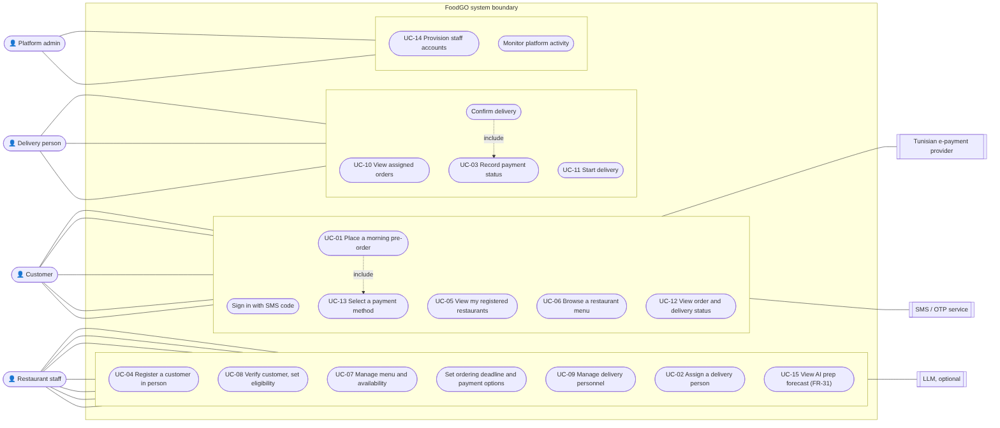

# FoodGO — Software Requirements Specification

**Course:** CS 488 AI-First Software Engineering, Fall 2026 · **Lab 2 deliverable** (template: IEEE 830 / ISO/IEC/IEEE 29148)
**Team:** Hamza Ben Labiedh, Ali Chamakh, Mohamed Krid · **Version:** 1.0, 1 Nov 2026 · **Repository:** https://github.com/HamzaBL04/foodGO

> **How to read this document.** Requirements keep the identifiers of our earlier specification (FR-01–FR-30, BR-01–BR-16) so that every trace still works. Requirements added later by team decision are FR-31, FR-32, BR-17, BR-18 and NFR-13–NFR-15. Each requirement carries a status: *Validated* (from our validated elicitation document), *Team decision* (recorded in an ADR), *Proposed* (a position taken to make the system buildable, still to be validated with stakeholders) or *Unresolved* (a business decision not yet made, which must not be invented).
>
> This file is generated by `docs/lab2-srs/build_srs.py`. Sections 4–5 come from `docs/lab3-practical/SRS_SKELETON.md`; the use cases, elicitation log, analysis table and review log come from the Lab 3 worksheet; the test column of Section 6 comes from the test suite. Edit those sources, not this file.

---

## 1. Introduction

### 1.1 Purpose

This document specifies what FoodGO must do and how well it must do it. It is written for the three team members who build and test FoodGO, for the course instructor who evaluates it, and for anyone who maintains it later. It is the reference for design (Lab 4 SDD), for implementation, and for the tests listed in Section 6.

### 1.2 Scope

FoodGO is a **pre-order lunch platform for one area of Tunis: Lac 3 / Zone Industrielle Le Kram** (one area, known by both names).

**The problem.** Traffic in the area gets heavy at lunchtime because many employees leave their workplace at the same moment to get food. Restaurants are then swamped by everyone arriving at once and cook without knowing how much they will sell.

**The product.** An employee orders lunch in the morning, before a deadline set by the restaurant. At the deadline the restaurant knows exactly what to cook, and its own delivery staff bring the food to the employee's workplace at noon. Employees stay at their desks; many individual lunch trips become a few planned delivery runs. **The platform coordinates; the restaurant delivers.**

**Benefits and goals:** less lunchtime traffic in the area (team goal, ADR-0007); shorter lunch-hour waiting and ordering moved before lunch (BG-01, BG-02); better preparation planning (BG-03, BG-04); organised delivery (BG-05); convenient payment (BG-06); restaurants control who they serve (BG-07); accurate, visible orders (BG-08, BG-09).

**In scope:** in-person customer registration and SMS-code sign-in; menus and availability; morning pre-orders with a restaurant deadline; customer verification; the restaurant's own delivery team (assignment, start, confirmation); cash on delivery and Tunisian e-payment status; account provisioning; administrator monitoring; an advisory prep forecast; the service-area rules.

**Out of scope (this release):** other areas of Tunis; customer self-registration; order cancellation, restaurant rejection, failed delivery, refunds; delivery fees; GPS tracking; a platform-employed delivery fleet; a named real payment provider; staggered delivery windows.

### 1.3 Definitions, acronyms, abbreviations

The key terms are below; the full glossary is Appendix 7.3.

| Term | Meaning |
|---|---|
| Customer | An employee or student whose workplace is in the service area |
| Customer account | The access a restaurant creates for a customer in person |
| Workplace | The office, factory, school or institution a customer belongs to |
| Service area | Lac 3 / Zone Industrielle Le Kram |
| Delivery person | A person employed and equipped by a restaurant to deliver its orders |
| Ordering deadline | The restaurant's daily cut-off time for that day's orders |
| FR / NFR / BR | Functional requirement / non-functional requirement / business rule |
| UC | Use case |
| BG | Business goal (BG-01–BG-09) |
| ADR | Architecture Decision Record (`docs/decisions/`) |
| OTP | One-time password, sent by SMS to sign in |
| MoSCoW | Must / Should / Could / Won't priority scale |
| TND, millime | Tunisian dinar; 1 TND = 1,000 millimes |

### 1.4 References

| Reference | Used for |
|---|---|
| FoodGO Software Specification (`docs/lab3-specification/`) | The validated requirements FR-01–FR-30, BR-01–BR-16, quality attributes, 36 unresolved items |
| Lab 3 practical worksheet (`docs/lab3-practical/`) | Stakeholders, elicitation, analysis table, use cases, peer review |
| Lab 4 Software Design Document (`docs/lab4-sdd/`) | Use-case register (Appendix A), design decisions |
| ADR-0004 (AI forecast), ADR-0007 (service area) | Requirements added after the specification |
| Product backlog (`docs/requirements/BACKLOG.md`) | User stories and MoSCoW priorities |
| Traceability matrix (`docs/requirements/TRACEABILITY.md`) | Requirement → code → test, generated from the repository |
| CS 488 Lab 2 brief | SRS structure and the validation checklist |

### 1.5 Overview of the document

Section 2 describes the product's context, users and constraints. Section 3 shows the use cases. Sections 4 and 5 are the functional and non-functional requirements. Section 6 traces every requirement to its source, use case and test, and records the validation. Section 7 holds the elicitation log, the requirements analysis table and the glossary.

---

## 2. Overall Description

### 2.1 Product perspective

FoodGO is a new, self-contained web application. Today, employees in the area walk or drive to restaurants at noon, or phone them, and restaurants learn their demand only when customers arrive. FoodGO replaces that with morning ordering.

It sits between three parties and a few external services:

- **Customers** use a phone-sized web interface to order and follow their orders.
- **Restaurants** use a desktop interface to manage menus, register customers, see orders and assign their own delivery persons.
- **Delivery persons** use a phone-sized interface to see and complete their assignments.
- **The platform administrator** creates restaurants and staff accounts and monitors activity.
- **External services:** a Tunisian e-payment provider, an SMS/OTP service, a notification channel, and (optionally) an LLM for the forecast note. None is selected yet; each is reached through a replaceable adapter.

Preparing food, transporting it and employing or equipping delivery persons stay outside the system (BR-06, BR-07).

### 2.2 Product functions

- Register a customer in person and let them sign in with an SMS code
- Show each customer only the restaurants that registered them, with menus and availability
- Take pre-orders before the restaurant's deadline and refuse them after it
- Keep every restaurant and workplace inside the service area
- Show restaurants their orders live, with the information needed to verify the customer
- Let restaurants assign orders to their own delivery persons, who start and confirm deliveries
- Record the payment method and status (cash on delivery or e-payment)
- Show customers the live status of their orders
- Give restaurants an advisory forecast of the next service's dishes
- Let the administrator provision restaurants and staff and monitor activity

### 2.3 User classes and characteristics

| User class | Characteristics | Frequency | Priority |
|---|---|---|---|
| Customer (employee or student in the area) | Uses a phone; little time in the morning; may have no prior experience of food apps; Arabic, French or English speaking | Daily, a few minutes | Primary |
| Restaurant staff | Uses a desktop or tablet at the counter; busy at noon; registers customers face to face | Throughout the day | Primary |
| Delivery person | Uses a phone while moving; needs large, simple controls and the cash amount up front | During lunch deliveries | Primary |
| Platform administrator | Technical; sets up restaurants and accounts; reads monitoring | Occasional | Secondary |

### 2.4 Operating environment

- **Clients:** current mobile and desktop browsers (see NFR-14). No app installation.
- **Server:** one Node.js process with a local SQLite database, on any machine that can run Node.js 22 or later.
- **Time zone:** Africa/Tunis; ordering deadlines are local times.
- **Network:** internet access between clients and server; the external services are optional during development (sandboxes).

### 2.5 Design and implementation constraints

- The platform coordinates and never employs, schedules or equips delivery persons (BR-06, BR-07).
- Every restaurant's data is visible only to that restaurant (BR-09); customer data only to authorised parties (BR-15).
- Customer accounts are created only by restaurants, in person (BR-05, BR-16).
- FoodGO operates only in the service area; restaurants outside it cannot join (BR-17, BR-18).
- External providers must be replaceable without changing business rules, because none is selected yet (NFR-10).
- Business decisions marked Unresolved in the specification must not be invented in the implementation.

### 2.6 Assumptions and dependencies

- The specification's assumptions A-01–A-15 hold, **except A-13** ("AI is out of scope"), which the team withdrew on 1 Nov 2026 for an advisory forecast only (ADR-0004, Proposed).
- Restaurants in the area are willing to deliver with their own staff (A-04–A-07).
- **Dependencies:** an SMS/OTP provider and a Tunisian e-payment provider must be chosen before production (open question Q-22); the service window used for availability (NFR-11) and the compliance obligations (NFR-15) are business decisions still to be made.
- The lunchtime-traffic problem is assumed from the team's knowledge of the area; it will be confirmed by interviews in Sprint 2.

---

## 3. System Features / Use Cases

### 3.1 Use case diagram

**Actors:** Customer, Restaurant staff, Delivery person, Platform administrator; external systems: Tunisian e-payment provider, SMS/OTP service, LLM (optional).

**Use-case register** (derived in the Lab 4 SDD, Appendix A; UC-15 added with FR-31):

| UC | Name | Primary actor | Requirements |
|---|---|---|---|
| UC-01 | Place a morning pre-order | Customer | FR-09–FR-15, FR-32, BR-01, BR-17 |
| UC-02 | Assign a delivery person and complete delivery | Restaurant staff, Delivery person | FR-19–FR-23 |
| UC-03 | Record payment status | Delivery person (system) | FR-25–FR-28 |
| UC-04 | Register a customer in person | Restaurant staff | FR-01–FR-04, FR-32 |
| UC-05 | View the restaurants that registered me | Customer | FR-05 |
| UC-06 | Browse a restaurant menu | Customer | FR-06 |
| UC-07 | Manage menus and item availability | Restaurant staff | FR-07, FR-08 |
| UC-08 | Verify a customer and record eligibility | Restaurant staff | FR-16, FR-17 |
| UC-09 | Manage the restaurant's delivery persons | Restaurant staff | FR-18 |
| UC-10 | View assigned orders and delivery information | Delivery person | FR-20, FR-21 |
| UC-11 | Update delivery status | Delivery person | FR-22 |
| UC-12 | View order and delivery status | Customer | FR-24 |
| UC-13 | Select a payment method | Customer | FR-25, FR-26 |
| UC-14 | Provision staff and delivery accounts | Administrator, Restaurant staff | FR-29, FR-30 |
| UC-15 | View the AI prep forecast | Restaurant staff | FR-31 |

### 3.2 Detailed use case descriptions

{{USE_CASES}}

---

## 4. Functional Requirements

{{FUNCTIONAL}}

---

## 5. Non-Functional Requirements

{{NON_FUNCTIONAL}}

---

## 6. Requirements Traceability Matrix

### 6.1 Matrix

Source = where the requirement came from; Use case = Section 3; Test case = an automated test in the repository that checks it (from `docs/requirements/TRACEABILITY.md`; full lists there).

{{RTM}}

### 6.2 Validation checklist

| Check | Result |
|---|---|
| No two requirements contradict each other | ☑ Three contradictions found in review and fixed (FR-31 vs. "AI out of scope", FR-01 vs. BR-16, FR-32 vs. the old "many campuses and zones" scalability) |
| No duplicate requirements | ☑ The deadline rule (FR-12, FR-13, BR-01) made non-overlapping: accept strictly before, reject at or after |
| Every requirement is traceable to a stakeholder/source | ☑ Source column of 6.1 |
| Every requirement is testable | ☑ Vague verbs rewritten; every FR and BR has an automated test (6.1). Two NFRs are not yet testable by design: NFR-11 (service window undecided) and NFR-13 (target numbers after Sprint 2 interviews) |
| No implementation details leaked into requirements | ☑ Tool names and code identifiers removed from FR-32 and the NFRs; they live in the SDD |
| All relevant NFR categories covered | ☑ Performance, Security, Privacy, Usability, Accessibility, Reliability, Availability, Scalability, Maintainability, Testability, Observability, Interoperability, Portability, Compatibility, Legal/compliance (NFR-14 and NFR-15 added for this check) |
| Terminology is consistent | ☑ One term per concept, defined in 1.3 and 7.3 |

### 6.3 Peer review log

{{REVIEW}}

---

## 7. Appendices

### 7.1 Elicitation log

**Stakeholders**

{{STAKEHOLDERS}}

**Elicitation activities**

| Technique | Participants | Date | Key findings (raw notes) |
|---|---|---|---|
| Document analysis | Team, on the validated Requirements Elicitation Document | Sep 2026 (Sprint 0) | Everyone orders lunch in the same short window; restaurants are swamped and cook without knowing demand. · Customers must be registered **in person** by the restaurant; no self-sign-up. · The restaurant delivers with its own staff and equipment. · Cash on delivery plus Tunisian e-payment. · Customers want to see order progress. · Cancellation, refunds and failed delivery left open. |
| Interview | Hamza Ben Labiedh, as product owner | 1 Nov 2026 | "The app idea is not simply preordering food … only in **Lac 3, zone industrielle Kram**, to avoid **heavy traffic during lunchtime** in the area." · "Lac 3, zone indus Kram are the **same zone**." · "**Outside the area cannot join** FoodGO." |
| Prototyping (walkthrough of the working MVP) | Team | 1 Nov 2026 | The deadline must be visible before ordering. · Staff want the order queue to update live. · Delivery persons need the cash amount up front. · A late order must say when ordering closed. |
| Role-play interviews (planned) | An employee persona; a restaurant-staff persona | 2 Nov 2026 (in class) | _To be recorded in the Lab 3 worksheet, Step 1, using its interview guide._ |

### 7.2 Requirements analysis table

{{ANALYSIS}}

### 7.3 Glossary

| Term | Definition |
|---|---|
| Advisory forecast | A prediction shown to restaurant staff that never changes any order, payment, eligibility or menu record (FR-31) |
| Assignment | The link between one order and one of the restaurant's own delivery persons |
| Customer | An employee or student whose workplace is in the service area and whom a restaurant has registered |
| Customer account | The access a restaurant creates for a customer in person; one account per person, one membership per restaurant |
| Delivery person | A person employed and equipped by a restaurant to deliver its orders |
| Eligibility | A restaurant's decision that a registered customer may order from it (BR-04) |
| Membership | The record that a restaurant registered a customer, holding the eligibility flag |
| Ordering deadline | The restaurant's daily cut-off time; an order at or after it is refused |
| Pre-order | An order placed before the deadline for that day's lunch |
| Restaurant staff | People who run a restaurant's operations in FoodGO: menus, registrations, orders, assignments |
| Service area | Lac 3 / Zone Industrielle Le Kram, the only place FoodGO operates |
| Workplace | The office, factory, school or institution a customer belongs to; always inside the service area |
