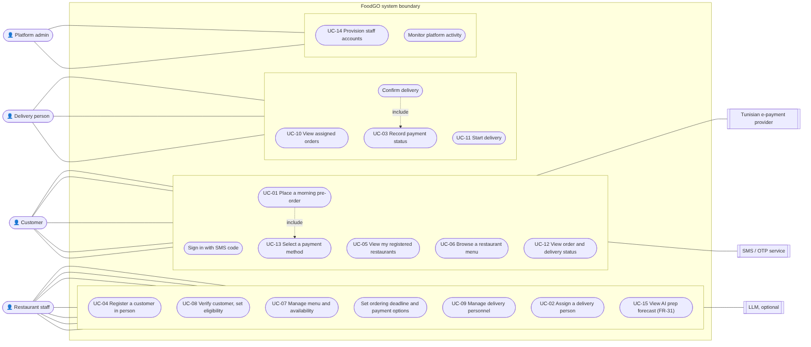

# Lab 3 — Applying requirements engineering to FoodGO

**Course:** CS 488 AI-First Software Engineering, Fall 2026 · **Team:** Hamza Ben Labiedh, Ali Chamakh, Mohamed Krid · **Date:** 1 Nov 2026
**PDF of this worksheet:** [`LAB3_REQUIREMENTS_WORKSHEET.pdf`](LAB3_REQUIREMENTS_WORKSHEET.pdf) · **SRS skeleton:** [`SRS_SKELETON.md`](SRS_SKELETON.md) · **Full specification (our earlier Lab 3 deliverable):** [`../lab3-specification/FoodGO_Software_Specification.pdf`](../lab3-specification/FoodGO_Software_Specification.pdf)

**Project pitch.** FoodGO lets employees in **Lac 3 / Zone Industrielle Le Kram** pre-order lunch in the morning, so they stay at their desks at noon and the area's lunchtime traffic drops. The restaurant's own delivery staff bring the food.

**How this worksheet was built.** Our team already turned its validated elicitation document into a full specification (FR-01–FR-30, BR-01–BR-16, quality requirements, 36 unresolved items). This worksheet walks the six Lab 3 steps over that material and adds what changed since: FR-31 (AI forecast, ADR-0004) and FR-32 / BR-17 (service area, ADR-0007).

> **Honest notes.** Prepared by Hamza with Claude; Ali and Mohamed review it at the team meeting on 2 Nov. The **role-play interviews of Step 1 have not been run yet**: the guide below is ready for them, and their findings rows are empty on purpose. Step 5's review comes from an **independent AI reviewer** because no other team was available; a peer team's review is still to add. Instructor checkpoints are **not** signed yet.

---

## Step 1 — Elicit requirements

### Stakeholder list

| Stakeholder | Interest / concern |
|---|---|
| Customer — employee or worker in Lac 3 / ZI Le Kram | Order lunch quickly in the morning; get it on time at noon without driving out; see where the order is; pay cash or online |
| Customer — student at an institution in the area | Same as employees; spec keeps students as a customer type, the area decides who is served |
| Restaurant owner | Predictable demand, fewer noon rushes, control over who may order (BR-04) |
| Restaurant manager | Set the ordering deadline and payment options; register customers in person |
| Restaurant staff | See the day's orders early, prepare exact quantities, assign their own couriers |
| Delivery person (employed by the restaurant) | See only their own deliveries with the address, phone, items and cash to collect |
| Platform administrator | Provision restaurants and staff accounts; monitor activity without touching orders |
| Platform owner | A product that works and can grow; reputation; no delivery workforce of its own (BR-06) |
| Payment provider (Tunisian e-payment) | A clean integration; correct payment status |
| Workplace / campus organization in the area | Employees eat on time and come back on time; fewer lunchtime trips around the site |
| SMS / notification service | Clear contract for sending one-time codes and notices |

### Elicitation log

| Technique | Participant | Key findings (raw notes) |
|---|---|---|
| Document analysis | Our validated Requirements Elicitation Document (Lab 2), summarised in the specification | Lunch is ordered by everyone in the same short window; restaurants are swamped and cook without knowing demand. Customers must be registered **in person** by the restaurant, no self-sign-up. Restaurant delivers with its own staff and equipment. Cash on delivery plus Tunisian e-payment. Customers want to see order progress. Many failure cases (cancel, refund, failed delivery) left open. |
| Product-owner interview (live, 1 Nov 2026) | Hamza, acting as product owner | "The app idea is not simply preordering food … only in **Lac 3, zone industrielle Kram**, to avoid **heavy traffic during lunchtime** in the area." Follow-up: "Lac 3, zone indus Kram are the **same zone**." Follow-up: "**Outside the area cannot join** FoodGO." → FR-32, BR-17, ADR-0007; also settles the spec's unresolved item 35 (initial deployment area). |
| Prototype walkthrough | Team, on the midterm MVP | The deadline must be visible before ordering; staff want the order queue live; couriers need the cash amount up front. (Used for NFR-07 and the UI.) |
| Role-play interview 1 | _Interviewer: ____ · Persona: an employee at a Lac 3 office_ | _to fill in class (2 Nov)_ |
| Role-play interview 2 | _Interviewer: ____ · Persona: staff at a restaurant in ZI Le Kram_ | _to fill in class (2 Nov)_ |

**Role-play interview guide (10 minutes each).**
- *Employee persona:* "Walk me through your lunch on a normal workday, from the moment you get hungry." · "How long does it take you to get food and come back? What slows you down?" · "What would make you order the evening before or in the morning instead?" · "How would you want to pay, and how do you want to know your food is coming?"
- *Restaurant persona:* "What does your kitchen look like between 11:30 and 13:30?" · "How do you decide how much to cook?" · "Who delivers today, and how do you organise them?" · "When would you need the last order to be able to cook everything on time?"

☐ Checkpoint: show our stakeholder list to the instructor — _to do in class_

---

## Step 2 — Analyze & classify

| ID | Type | Category | Description (from the raw notes) | Priority | Source |
|---|---|---|---|---|---|
| C-01 | FR | Access | Restaurant staff register a customer in person; no self-sign-up | Must | Elicitation doc → FR-01–FR-04, BR-16 |
| C-02 | FR | Access | Customer signs in with phone number and a one-time code | Must | Elicitation doc → FR-03, BR-05 |
| C-03 | FR | Service area | Serve only restaurants and workplaces in Lac 3 / ZI Le Kram; restaurants outside cannot join | Must | PO interview → FR-32, BR-17 |
| C-04 | FR | Ordering | Customer sees only restaurants that registered them, with menus and availability | Must | Elicitation doc → FR-05–FR-08 |
| C-05 | FR | Ordering | Order before the restaurant's deadline; refused after it | Must | Elicitation doc → FR-12, FR-13, BR-01 |
| C-06 | FR | Ordering | Exact total and a unique order number | Must | Elicitation doc → FR-11, FR-14 |
| C-07 | FR | Delivery | Restaurant assigns its own delivery person before dispatch | Must | Elicitation doc → FR-19, BR-06, BR-10 |
| C-08 | FR | Delivery | Courier sees only their assignments and confirms delivery | Must | Elicitation doc → FR-20–FR-23, BR-08, BR-11 |
| C-09 | FR | Payment | Cash on delivery or Tunisian e-payment; payment status recorded | Must (cash) / Should (real e-payment provider) | Elicitation doc → FR-25–FR-28 |
| C-10 | FR | Tracking | Customer follows order status live | Should | Elicitation doc → FR-24 |
| C-11 | FR | Planning | Forecast of tomorrow's dishes, advice only | Should | Team decision → FR-31, ADR-0004 |
| C-12 | NFR | Performance | Pages and API feel instant; ordering under 2 s | Must | Spec §7 → NFR-01 |
| C-13 | NFR | Security | Roles, restaurant scope, hashed credentials, rate limits | Must | Spec §7, §12 → NFR-02 |
| C-14 | NFR | Privacy | Customer data only for authorised parties; none sent to the LLM | Must | Spec §7, BR-15 → NFR-03 |
| C-15 | NFR | Reliability | No lost, duplicate or half-written orders | Must | Spec §7 → NFR-04 |
| C-16 | NFR | Usability | Ordering in a few screens; deadline visible | Should | Prototype walkthrough → NFR-07 |
| C-17 | NFR | Accessibility | WCAG 2.2 AA | Should | Spec §7 → NFR-08 |
| C-18 | FR | Order lifecycle | Customer cancels an order | Won't (this release) | Elicitation doc: unresolved (cancellation) |
| C-19 | FR | Delivery | Live GPS tracking of the courier | Won't | Spec §20.11 do-not-implement list |

☐ Checkpoint: instructor reviews at least three requirements for clarity — _to do in class_

---

## Step 3 — Final requirement statements (draft, before peer review)

Functional requirements keep the identifiers of our specification (FR-01–FR-30) and add FR-31 and FR-32. Business rules BR-01–BR-17 constrain them (BR-17 is new). Non-functional requirements are NFR-01–NFR-12 from our backlog.

| ID | Requirement statement | Priority |
|---|---|---|
| FR-01 | The system shall support customer account creation. | Must |
| FR-02 | The system shall collect the customer's full name. | Must |
| FR-03 | The system shall collect the customer's phone number. | Must |
| FR-04 | The system shall collect the customer's workplace or educational institution. | Must |
| FR-05 | The system shall display available restaurants to the customer. | Must |
| FR-06 | The system shall allow customers to view restaurant menus. | Must |
| FR-07 | The system shall allow restaurants to manage their menus. | Must |
| FR-08 | The system shall allow restaurants to mark menu items available or unavailable. | Must |
| FR-09 | The system shall allow customers to select menu items. | Must |
| FR-10 | The system shall allow customers to specify quantities. | Must |
| FR-11 | The system shall calculate the order total from item prices and quantities. | Must |
| FR-12 | The system shall accept pre-orders before the restaurant-defined ordering deadline. | Must |
| FR-13 | The system shall prevent orders after the applicable ordering deadline. | Must |
| FR-14 | The system shall confirm submitted orders with a unique identifier. | Must |
| FR-15 | The system shall make the submitted order available to the corresponding restaurant. | Must |
| FR-16 | The system shall provide authorized restaurant personnel with the customer information needed for verification. | Must |
| FR-17 | The system shall support restaurant verification that a customer belongs to the applicable target organization. | Must |
| FR-18 | The system shall allow restaurants to manage their delivery personnel. | Must |
| FR-19 | The system shall allow restaurants to assign orders to delivery personnel. | Must |
| FR-20 | The system shall allow delivery personnel to view their assigned orders. | Must |
| FR-21 | The system shall provide delivery personnel with the information necessary to perform assigned deliveries. | Must |
| FR-22 | The system shall allow delivery personnel to update delivery status. | Must |
| FR-23 | The system shall allow delivery personnel to confirm successful delivery. | Must |
| FR-24 | The system shall allow customers to view order and delivery status. | Should |
| FR-25 | The system shall allow customers to select an available payment method. | Must |
| FR-26 | The system shall support payment upon delivery where enabled by the restaurant. | Must |
| FR-27 | The system shall support approved third-party Tunisian electronic payment services where integrated. | Should |
| FR-28 | The system shall record payment status against the order. | Must |
| FR-29 | The system shall allow the platform to provision accounts for restaurant staff. | Must |
| FR-30 | The system shall allow restaurants to provision accounts for their delivery personnel. | Must |
| FR-31 | The system shall give restaurant staff an advisory forecast of the next service's dishes, which never changes orders, payments, eligibility or the menu. | Should |
| FR-32 | The system shall record a service zone for every restaurant and workplace and accept only Lac 3 / Zone Industrielle Le Kram. | Must |
| BR-17 | An order shall be accepted only when both the restaurant and the customer's workplace are inside the service area. | Must |
| NFR-01 | 95 % of API requests shall complete in under 500 ms and 99 % in under 1.5 s; order submission in under 2 s. | Must |
| NFR-02 | The system shall authenticate users, enforce role and restaurant-scoped authorisation, hash credentials and rate-limit sign-in. | Must |
| NFR-03 | Customer data shall be visible only to authorised parties, and no personal data shall be sent to the LLM. | Must |
| NFR-04 | The system shall not lose, duplicate or half-write an order. | Must |
| NFR-05 | Business rules shall be separated from the UI and persistence; complexity at most 10 per function. | Should |
| NFR-06 | Each feature shall have unit and integration tests; line coverage at least 60 %. | Must |
| NFR-07 | A customer shall be able to place an order in at most 4 screens, with the deadline visible before ordering. | Should |
| NFR-08 | The user interface shall meet WCAG 2.2 AA. | Should |
| NFR-09 | Security-relevant actions shall be written to an audit log; a health endpoint shall exist. | Should |
| NFR-10 | Payment, SMS/OTP, notification and LLM providers shall be reached through replaceable adapters. | Should |
| NFR-11 | The system shall be available 99.5 % of the time during service hours. | Should |
| NFR-12 | The system shall run with Node.js 22+ and no external service. | Could |

☐ Checkpoint: read our top three Must requirements aloud to the instructor (FR-13, FR-32, BR-17) — _to do in class_

---

## Step 4 — Use cases

**Actors:** Customer, Restaurant staff, Delivery person, Platform administrator. External systems: Tunisian e-payment provider, SMS/OTP service, LLM (optional).

### Use case UC-01 — Place a morning pre-order

- **Use Case ID:** UC-01
- **Name:** Place a morning pre-order
- **Actor:** Customer (an employee registered by the restaurant)
- **Preconditions:** The customer is signed in; a restaurant registered them and they are eligible; the restaurant and the customer's workplace are in Lac 3 / Zone Industrielle Le Kram; it is before the restaurant's ordering deadline.
- **Main flow:**
  1. The customer opens one of their restaurants and sees today's menu and the time left before the deadline.
  2. The customer chooses available dishes and quantities; the system shows the exact total.
  3. The customer chooses cash on delivery or e-payment (only methods the restaurant enabled).
  4. The customer submits the order.
  5. The system checks registration, service area, deadline, availability and payment method, saves the order, and shows an order number FG-XXXXXX.
  6. The restaurant sees the new order in its queue immediately.
- **Alternate flow:** 5a. The deadline has passed → the order is refused ("Ordering for today closed at HH:MM", ORDER-001). 5b. A dish became unavailable → refused (ORDER-002). 5c. The restaurant or workplace is outside the service area → refused (ORDER-003). 5d. E-payment is declined → no order is created (PAY-001). 4a. The customer's connection drops and the app retries → the same order is returned, not a second one.
- **Postconditions:** One order with its items, total, payment record and deadline snapshot exists, visible to this customer and this restaurant only.
- **Linked requirements:** FR-05, FR-06, FR-09–FR-15, FR-25, FR-26, FR-32; BR-01, BR-02, BR-04, BR-12, BR-16, BR-17; NFR-01, NFR-04

### Use case UC-04 — Register a customer in person

- **Use Case ID:** UC-04
- **Name:** Register a customer in person
- **Actor:** Restaurant staff
- **Preconditions:** The staff member is signed in to their own restaurant; the customer is present with an ID.
- **Main flow:**
  1. The staff member opens Customers and enters the customer's full name and phone number.
  2. The staff member picks the customer's workplace (each workplace is in the service area).
  3. The staff member checks the customer's identity and ticks "I checked their identity in person".
  4. The system creates the customer (or reuses the existing person with that phone number) and adds a membership for this restaurant.
  5. The customer can now sign in with an SMS code and sees this restaurant.
- **Alternate flow:** 2a. The workplace is missing → the staff member adds it with its zone; a place outside the area is refused (VAL-001). 3a. Identity not confirmed → registration refused (BR-05). 4a. The customer is already registered at this restaurant → refused as a duplicate.
- **Postconditions:** One canonical customer record and one active, eligible membership for this restaurant; nothing visible to other restaurants.
- **Linked requirements:** FR-01–FR-04, FR-16, FR-17, FR-32; BR-04, BR-05, BR-15, BR-16

☐ Checkpoint: show our use-case diagram to the instructor — _to do in class_

---

## Step 5 — Peer review & validation

**Reviewing team.** No other team was available for the swap, so an **independent AI reviewer** (a fresh Claude agent that knew nothing about the project) applied the lab's validation checklist to our specification, backlog and the two ADRs that added requirements. It changed nothing. We checked every issue against the documents before accepting it. A peer team's review is still to add in class.

**Validation checklist (applied to our own list by the reviewer):** ☑ no contradictions — 3 found and fixed · ☑ no duplicates — 1 found and merged · ☑ every requirement testable — vague verbs and number-free NFRs fixed · ☑ no implementation details — tool names and code identifiers removed · ☑ consistent terminology — glossary added.

| Reviewing team | Issue found | Our fix |
|---|---|---|
| Independent AI reviewer | **FR-31 contradicts the specification**, which puts AI out of scope (§2.2, AI-001, BG-03, do-not-implement item 05), yet the backlog shows it done. | FR-31 reworded to say exactly what it may and may not touch, and kept **Proposed**. SRS §2 records that the team withdrew A-13 (ADR-0004) and that stakeholder validation is pending. |
| Independent AI reviewer | **FR-32/BR-17 narrow the scope, but the spec still promises "many campuses and zones"**; items 10 and 35 still say unresolved; the joining rule had no number; FR-32 named code (`LAC3_ZI_KRAM`, migration). | Items 35 and 10 marked resolved by ADR-0007; joining rule numbered **BR-18** (also in the code, tests and traceability); FR-32 rewritten without code; new **NFR-13 Scalability** for the area's peak, target set after Sprint 2 interviews. |
| Independent AI reviewer | **FR-01 contradicts BR-16:** "support customer account creation" reads like self-sign-up, which BR-16 and §20.11 forbid. | FR-01 rewritten: staff create the account for their own restaurant; no self-registration. |
| Independent AI reviewer | **Vague, untestable verbs:** "manage" (FR-07, FR-18), "support" (FR-17, FR-26, FR-27); acceptance criteria that repeat the requirement. | Each rewritten with observable behaviour: FR-07 create/edit/remove items; FR-17 ineligible customer can neither see nor order; FR-26 pending → paid when cash collected; FR-27 order not created if payment declined; FR-11 exact to the millime. FR-18 limited to create and list (deactivation stays unresolved). |
| Independent AI reviewer | **Deadline stated three times (FR-12, FR-13, BR-01) and the boundary undefined.** | FR-12 "strictly before", FR-13 "at or after → rejected, deadline shown". Identifiers kept for traceability. |
| Independent AI reviewer | **NFRs without numbers or with tool names:** no load for NFR-01; NFR-11's service window undecided; helmet, express-rate-limit, Node.js 22, bcrypt named. | NFR-01 states its load (300 orders at one restaurant); NFR-11 flagged untestable until the service window is decided; NFR-02, 05, 10, 12 rewritten as qualities, tools moved to the SDD. |
| Independent AI reviewer | **Inconsistent terms:** workplace / organization / institution / campus; account / access / credentials; "courier"; area names. | One glossary term each in SRS §1 (Customer account, Workplace, Service area, Delivery person), used throughout Sections 4–5. |
| _Peer team (in class)_ | _to fill in_ | _to fill in_ |

**What the reviewer said we do well:** every story traces to FR/BR identifiers, unresolved items are marked blocked rather than guessed, and the Validated / Proposed / Unresolved labels grade each item honestly.

---

## Step 6 — Draft SRS skeleton

Sections 1–7 with Sections 4 and 5 completed (after the Step 5 revisions): [`SRS_SKELETON.md`](SRS_SKELETON.md).

---

## End-of-session submission checklist

- ☑ Stakeholder list for our project
- ☑ Elicitation log (document analysis, product-owner interview, prototype walkthrough; role-play interviews still to run)
- ☑ Requirements analysis table (19 candidates, classified and prioritised)
- ☑ Final requirements list with unique IDs
- ☑ Use-case diagram + two detailed use-case descriptions
- ☑ Peer review feedback log and revisions made (independent AI reviewer; a peer team's review still to add)
- ☑ Draft SRS skeleton with Sections 4–5 completed
- ☐ Instructor sign-off at each checkpoint — _not yet obtained_
