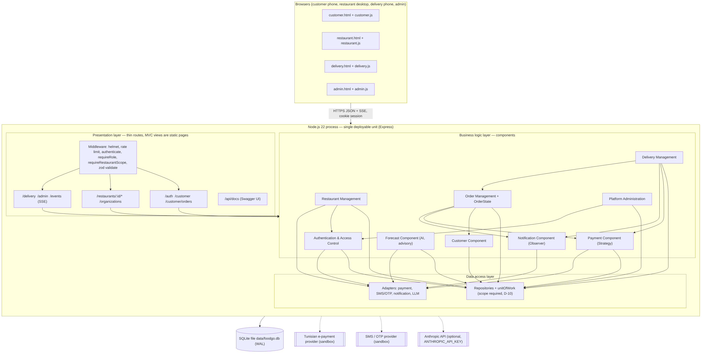
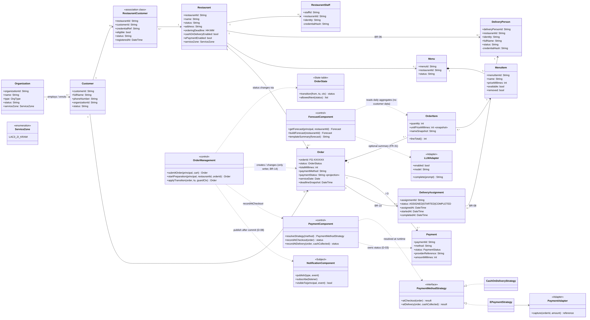
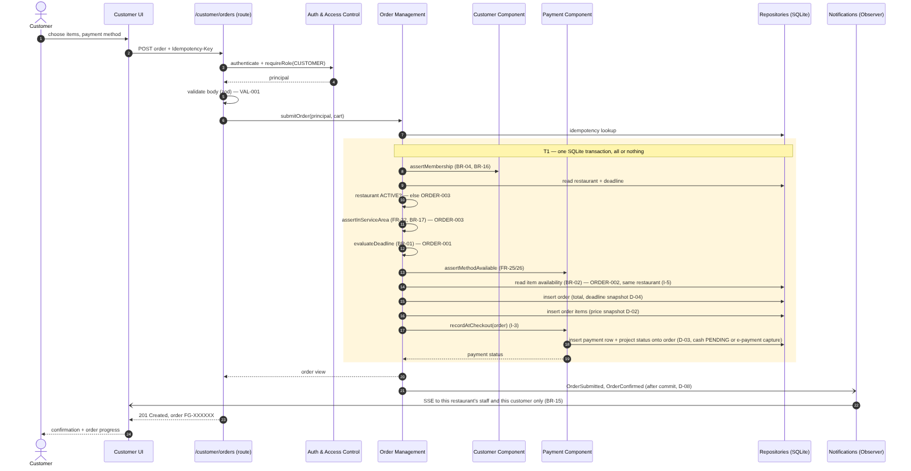
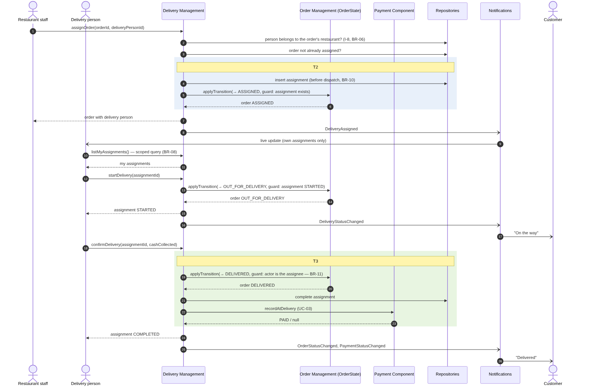

# Lab 5 — Designing our own project's architecture (FoodGO)

**Course:** CS 488 AI-First Software Engineering, Fall 2026 · **Team:** Hamza Ben Labiedh, Ali Chamakh, Mohamed Krid · **Date:** 1 Nov 2026
**Filled-in handout (Word):** [`Lab5_Design_Practical_Session_FoodGO.docx`](Lab5_Design_Practical_Session_FoodGO.docx) · **SDD skeleton:** [`SDD_SKELETON_SECTIONS_1-2.md`](SDD_SKELETON_SECTIONS_1-2.md)

**How we did this session.** Lab 4 produced our full design document before any code existed. We did Lab 5 after building the midterm MVP, so every table below describes the design **as built**. The changes since Lab 4 are marked **(new)**: the AI forecast (ADR-0004) and the single service area, Lac 3 / Zone Industrielle Le Kram (ADR-0007). Every choice traces to a requirement (FR/BR) or a decision (D-xx, ADR).

> **Honest notes.** This worksheet was prepared by Hamza with Claude, and the other two members review it at the team meeting on 2 Nov. Step 6's peer review comes from an **independent AI reviewer**, because no other team was available; its rows are labelled as such, and a row is left for the peer team in class. The instructor checkpoints have **not** been signed yet.

---

## Step 1 — Methodology & architecture

**Team discussion.** FoodGO is **data-centric** (orders, menus, memberships, payments must always agree). It is **lightly real-time**: live order status, but nothing needs sub-second guarantees. It is **not** made of independent services: one team, one database, one area, and a short morning ordering peak.

| Option considered | Pros for our project | Cons for our project | Chosen? |
|---|---|---|---|
| **Layered architecture** (presentation → business → data access) | Access rules (BR-09, BR-15), the deadline (BR-01) and the service area (BR-17) hold on every request because no screen can reach the database without a business component. Easy to test layer by layer. | One process and one database; scaling means scaling the whole app. | ✅ **Primary style** |
| **Microservices** | Independent scaling and deployment per component. | One team, one area, no independent scaling need. Splitting components that share orders turns each order into a distributed transaction and adds network failures to our hardest requirement (one correct order). | ❌ Deferred (revisit conditions in SDD §2.1.4) |
| **Event-driven** | Status changes reach customer, restaurant and courier without the order code knowing them (FR-15, FR-24). | Hard to follow; an event handler must never roll back a committed order. | ✅ **Only for notifications**, sent after commit (D-08) |
| **Client–server** | Four client roles against one central record. | — | ✅ Communication model (REST JSON + SSE) |
| **Object-Oriented Design** (methodology) | The domain is entity-rich; rules are invariants on objects (an order's status, a menu item's availability). | Needs care to keep classes small. | ✅ **Domain model** |
| **Component-Oriented Design** (methodology) | The specification's functional areas map one-to-one to components with narrow interfaces. | Interfaces must be designed up front. | ✅ **System structure** |

**Justification.** FoodGO's hardest requirement is correctness, not scale. A layered monolith makes the access rules, the ordering deadline and the service-area rule structural, while one team serving one area has no reason to pay the cost of microservices. Components are already separated by responsibility, so a later split would be a packaging change. Process: Scrum with one-week sprints (proposal §6).

☐ Checkpoint: explain our choice to the instructor in one minute — _to do in class_

---

## Step 2 — High-level component design

External systems (dashed in the diagram): Tunisian e-payment provider, SMS/OTP provider, Anthropic API (optional). The restaurant's kitchen and its delivery people's transport are outside the software boundary (BR-06, BR-07).

| Component | Responsibility | Talks to |
|---|---|---|
| Presentation (4 UIs + routes + middleware) | Validate input (zod), authenticate, check role and restaurant scope, call **one** component, return JSON / SSE | Business components; browsers |
| Authentication & Access Control | Password sign-in (staff, delivery, admin), SMS one-time code (customers), sessions, staff provisioning (FR-01, FR-29) | Repositories; SMS adapter |
| Customer | A customer's restaurants, menus and profile; membership check (BR-04, BR-16) | Repositories |
| Restaurant Management | Menu and availability, deadline and payment settings, in-person registration, workplaces **with their zone (new, FR-32)**, delivery team (FR-30) | Repositories |
| Order Management (+ OrderState) | Only creator/changer of orders: **service-area check (new, BR-17)**, deadline gate, totals, status changes (BR-01, BR-14) | Customer, Payment, Notification, Repositories |
| Delivery Management | Assign to the restaurant's own staff, delivery info, start, confirm (BR-08, BR-10, BR-11) | Order Management, Payment, Notification, Repositories |
| Payment | Strategy per method; owns payment status (FR-25–FR-28) | Payment adapter, Repositories |
| Notification | Events after commit; who may see what (BR-15) | Notification adapter; SSE stream |
| Forecast **(new, FR-31)** | Advisory prep forecast from past orders; optional LLM note, no customer data | Repositories; LLM adapter |
| Repositories + unit of work | All SQL; restaurant scope is a required argument; transactions T1–T3 | SQLite |
| Adapters | Payment, SMS/OTP, notification, LLM behind narrow interfaces | External providers |

☐ Checkpoint: show our diagram and table to the instructor — _to do in class_

---

## Step 3 — Class modeling

| Class | Attributes | Operations | Related classes |
|---|---|---|---|
| **Restaurant** | `name`, `status`, `orderingDeadline` (HH:MM), `serviceZone` **(new)**, payment flags | `isOrderingOpen(now)`, `paymentMethods()`, `updateSettings()` | Menu (1..*), RestaurantStaff, DeliveryPerson (BR-06), RestaurantCustomer, Order |
| **Organization** (workplace) | `name`, `type`, `serviceZone` **(new)** | `create(name, type, zone)`, `isInServiceArea()` **(new)** | Customer (1..*) |
| **Customer** | `fullName`, `phoneNumber`, `organizationId` | `signInWithCode()`, `listMyRestaurants()`, `placeOrder()` | Organization, RestaurantCustomer, Order |
| **RestaurantCustomer** (membership, association class) | `eligible`, `status`, `credentialRef` | `register()`, `setEligibility()`, `assertActive()` | Restaurant, Customer |
| **MenuItem** | `name`, `priceMillimes`, `available` | `setAvailable()`, `edit()`, `remove()` (soft) | Menu (composition), OrderItem |
| **Order** | `orderId` (FG-XXXXXX), `status`, `totalMillimes`, `paymentStatus` (projection), `deadlineSnapshot`, `serviceDate` | `total()` (sum of its lines); a record otherwise — only **OrderManagement** creates or changes it | Customer, Restaurant, OrderItem (composition), Payment, DeliveryAssignment |
| **OrderItem** | `quantity`, `unitPriceMillimes` (snapshot), `nameSnapshot` | `lineTotal()` | Order, MenuItem |
| **Payment** | `method`, `status`, `amountMillimes`, `providerReference` | a record — written only by **PaymentComponent**, which also projects the status onto Order (D-03) | Order, PaymentComponent |
| **DeliveryAssignment** | `status` (ASSIGNED/STARTED/COMPLETED), `assignedAt`, `completedAt` | `assign()`, `start()`, `confirm()` | Order (0..1), DeliveryPerson |
| **OrderManagement** «control» | dependencies (repos, payments, notifications, clock) | `submitOrder(principal, cart)`, `startPreparation()`, `applyTransition(order, to, guardCtx)` | Order, OrderState, PaymentComponent, NotificationComponent |
| **PaymentComponent** «control» | strategy registry | `resolveStrategy(method)`, `recordAtCheckout(order)`, `recordAtDelivery(order, cashCollected)` | Payment, PaymentMethodStrategy |
| **ForecastComponent** «control» **(new, FR-31)** | LLM adapter, clock | `getForecast(principal, restaurantId)`, `buildForecast()`, `templateSummary()` | OrderItem (daily aggregates), LLMAdapter |
| **OrderState** (state table) | the transition table and guards | `transition(from, to, ctx)`, `allowedNext(status)` | OrderManagement |
| **PaymentMethodStrategy** (interface) | — | `atCheckout(order)`, `atDelivery(order, cashCollected)` | CashOnDeliveryStrategy, EPaymentStrategy, PaymentAdapter |

**Cohesion check (two classes for the instructor).**
- **OrderManagement** is the only writer of orders. It does not know who must be told when an order changes (that is Notification) or how money is taken (that is Payment).
- **DeliveryAssignment** only links one order to one of the restaurant's own couriers and tracks that link. It has no vehicle, shift or salary attributes on purpose (BR-07).

☐ Checkpoint: instructor reviews two classes for cohesion and single responsibility — _to do in class_

---

## Step 4 — Sequence diagrams (top two "Must have" use cases)

### UC-01 — Place a morning pre-order (US-11, FR-09–FR-14, BR-01, BR-17)

**Actors/objects:** Customer, Customer UI, Order route, Auth middleware, Order Management, Customer Component, Payment Component, Repositories, Notification.

1. Customer → Customer UI : choose dishes, quantities, payment method
2. Customer UI → Order route : `POST /customer/orders` + Idempotency-Key
3. Order route → Auth middleware : authenticate, require role CUSTOMER
4. Order route → Order route : validate body (zod) — else VAL-001
5. Order route → Order Management : `submitOrder(principal, cart)`
6. Order Management → Repositories : idempotency lookup (a retry returns the first order)
7. Order Management → Customer Component : `assertMembership` (BR-04, BR-16) — begins transaction T1
8. Order Management → Repositories : read restaurant and deadline; restaurant must be ACTIVE — else ORDER-003
9. Order Management → Order Management : `assertInServiceArea` **(new, BR-17)** — else ORDER-003
10. Order Management → Order Management : `evaluateDeadline` (BR-01) — else ORDER-001
11. Order Management → Payment Component : `assertMethodAvailable` (FR-25, FR-26)
12. Order Management → Repositories : read item availability (BR-02) — else ORDER-002
13. Order Management → Repositories : insert order (total, deadline snapshot D-04) and items (price snapshot D-02)
14. Order Management → Payment Component : `recordAtCheckout` → Repositories : insert payment row and project its status onto the order (D-03) — commit T1
15. Order Management → Notification : OrderSubmitted, OrderConfirmed (after commit, D-08)
16. Notification → Restaurant UI / Customer UI : live update (BR-15: only this restaurant and this customer)
17. Order route → Customer UI : 201 Created, order FG-XXXXXX

### UC-02 — Assign a delivery person and complete the delivery (US-16, US-18, FR-19–FR-23, BR-10, BR-11)

**Actors/objects:** Restaurant staff, Delivery person, Customer, Delivery Management, Order Management (OrderState), Payment Component, Repositories, Notification.

1. Restaurant staff → Delivery Management : `assignOrder(orderId, deliveryPersonId)`
2. Delivery Management → Repositories : check the person belongs to the order's restaurant (I-8, BR-06) and the order is not already assigned
3. Delivery Management → Repositories : insert assignment before dispatch (BR-10) — begins T2
4. Delivery Management → Order Management : `applyTransition(→ ASSIGNED)` — commit T2
5. Delivery Management → Notification : DeliveryAssigned → Delivery person sees it (own assignments only, BR-08)
6. Delivery person → Delivery Management : `startDelivery(assignmentId)`
7. Delivery Management → Order Management : `applyTransition(→ OUT_FOR_DELIVERY)`; Notification → Customer : "On the way"
8. Delivery person → Delivery Management : `confirmDelivery(assignmentId, cashCollected)` — begins T3
9. Delivery Management → Order Management : `applyTransition(→ DELIVERED)`, guard: actor is the assignee (BR-11)
10. Delivery Management → Repositories : complete assignment
11. Delivery Management → Payment Component : `recordAtDelivery` (cash marked paid) — commit T3
12. Delivery Management → Notification : OrderStatusChanged, PaymentStatusChanged → Customer : "Delivered"

**Extra, added after the peer review:** UC-15, the AI prep forecast (FR-31): aggregates only, optional LLM call with a template fallback, audited. [Diagram](../uml/sequence-uc15-forecast.png).

☐ Checkpoint: show our two sequence diagrams to the instructor — _to do in class_

---

## Step 5 — Design patterns

| Pattern | Problem solved | Where applied |
|---|---|---|
| **State** (table-driven variant) | BR-14 needs one coherent order status with illegal transitions impossible, while the failure states (cancel, reject, fail) are still undecided. A closed `if` chain would scatter the rule; a transition table with guards encodes the happy path once and lets a new state be added in one place. We use a table, not one class per state (honest wording after the peer review). | `src/domain/orderState.js` (`transition`, `allowedNext`); only Order Management calls it |
| **Strategy** | Payment methods are per-restaurant and open-ended, and no provider is chosen (Q-22). Without Strategy the ordering code would branch on every method. | `src/components/paymentComponent.js`: `CashOnDeliveryStrategy`, `EPaymentStrategy`, `resolveStrategy()` |
| **Adapter** | Payment, SMS, notification and LLM providers are third parties we don't control; business code must be testable without them. | `src/adapters/` (payment, SMS/OTP, notification, LLM); sandboxes today |
| **Observer** | One status change must reach customer, restaurant and courier, each seeing only what BR-15 allows, without Order Management knowing them. | `src/components/notificationComponent.js` (`publish`, `subscribe`, `visibleTo`); events after commit; SSE stream |
| **Repository + Unit of Work** | Every restaurant-owned query must be scoped (BR-09), and multi-row writes must be all-or-nothing (T1–T3). | `src/repositories/` (`requireScope`, `unitOfWork`) |

Patterns deliberately **not** used: Singleton (a global connection is a testing liability; the DB is injected), Decorator (its only candidate, delivery fees, has no requirement, Q-31).

---

## Step 6 — Peer review & SDD skeleton

**Reviewing team.** No other team was available for the swap, so we used an **independent AI reviewer**: a fresh Claude agent that knew nothing about the project, read only the repository, and applied a design-quality checklist (cohesion, coupling, requirement coverage, diagram–code consistency, UML notation, patterns). It changed nothing. Every issue below was checked against the code before we accepted it. A peer team's review is still to be added in class.

| Reviewing team | Issue found | Our fix |
|---|---|---|
| Independent AI reviewer | **Order Management wrote the payment status**, breaking D-03 ("only Payment writes it"), and the e-payment row was written twice. | **Fixed in code.** `recordAtCheckout` now inserts the payment row and projects its status in one call (`insertPaymentAndProject`); the extra write in `submitOrder` is gone. Unit test added. |
| Independent AI reviewer | **Component diagrams were incomplete:** no Platform Administration component, and the Delivery→Payment, Order→Customer, Restaurant Management→Auth and →adapters dependencies were missing. | **Fixed.** Both component diagrams (`component-deployment.mmd`, `architecture.md`) redrawn with the Admin component and all four dependencies. |
| Independent AI reviewer | **The AI forecast (FR-31) only appeared at component level**; no class or sequence diagram covered it, and the Observer subject was not shown. | **Fixed.** ForecastComponent, LLMAdapter «Adapter» and NotificationComponent «Subject» added to the class diagram; new sequence diagram UC-15 with the LLM-failure branch. |
| Independent AI reviewer | **The class diagram put behaviour on passive records** (`Order ..> OrderState`, `Payment ..> Strategy`) and missed attributes (`Restaurant.status`, `address`; `DeliveryPerson.status`, `fullName`). | **Fixed.** Control classes OrderManagement and PaymentComponent now carry those dependencies; attributes synced with the schema; RestaurantCustomer marked as an association class. |
| Independent AI reviewer | **Sequence notation errors:** `resolveStrategy` drawn as a message to the strategy, a reply skipping the Payment lifeline, UC-02 checks drawn inside T2, and no return messages. | **Fixed.** UC-03 uses a self-call and returns through the caller; UC-02 shows the checks before T2, with return messages; UC-01 shows the restaurant-status guard. |
| Independent AI reviewer | **State guards trust a context built by the caller** (`applyTransition` is public), and the "State" is really a transition table. | **Partly fixed.** Wording corrected everywhere to "table-driven state machine". The refactor (intention-revealing `markAssigned` / `dispatch` / `markDelivered`) is backlog story **US-33** for Sprint 2. |
| Independent AI reviewer (low) | `assertInServiceArea` checks that both places are in a served area, not that they are in the *same* area; adding a second area would silently allow cross-area orders. | **Recorded.** ADR-0007 now says the ADR that adds an area must decide cross-area ordering. No code change while there is one area. |
| _Peer team (in class)_ | _to fill in_ | _to fill in_ |

**What the reviewer said we do well:** clean layering with one composition root, repositories that require the restaurant scope, events published after commit, and real (not decorative) Strategy and Adapter implementations.

**SDD skeleton:** Sections 1–2 are in [`SDD_SKELETON_SECTIONS_1-2.md`](SDD_SKELETON_SECTIONS_1-2.md).

---

## End-of-session submission checklist

- ☑ Methodology & architecture decision with justification (Step 1)
- ☑ Component/architecture diagram + responsibility table (Step 2)
- ☑ Class diagram + class design table (Step 3)
- ☑ Two sequence diagrams for key use cases (Step 4)
- ☑ Design pattern justification table (Step 5)
- ☑ Peer review feedback log and revisions made (Step 6; independent AI reviewer, a peer team's review still to add)
- ☑ Draft SDD skeleton, Sections 1–2
- ☐ Instructor sign-off at each checkpoint — _not yet obtained_
