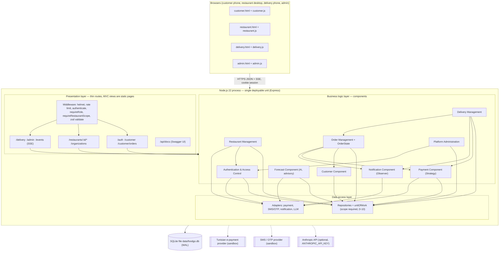

# FoodGO — Software Design Document (draft skeleton, Sections 1–2)

**Lab 5, Step 6 deliverable.** These are Sections 1–2 of the Lab 4 template (IEEE 1016), rewritten after building the midterm MVP. The full Lab 4 SDD is [`../lab4-sdd/FoodGO_Software_Design_Document.pdf`](../lab4-sdd/FoodGO_Software_Design_Document.pdf). This skeleton records what changed since then: the AI forecast (ADR-0004), the single service area (ADR-0007), and the design as actually built.

**Version:** 0.2 draft, 1 Nov 2026 · **Team:** Hamza Ben Labiedh, Ali Chamakh, Mohamed Krid

---

## 1. Introduction

### 1.1 Purpose

This document describes how FoodGO is designed: its architecture, components, classes, behaviour and the reasons behind each choice. Every design element traces back to a requirement in the Lab 3 specification (FR-xx, BR-xx) or to a later team decision recorded as an ADR.

Readers: the three team members, the course instructor, and anyone maintaining the code later.

### 1.2 Scope

FoodGO is a **pre-order lunch platform for one area of Tunis: Lac 3 / Zone Industrielle Le Kram** (one area, known by both names). Traffic there gets heavy at lunchtime because employees leave work at the same moment to get food. FoodGO moves ordering to the morning: an employee orders before a deadline the restaurant sets, the kitchen cooks exactly what was ordered, and the restaurant's own delivery staff bring lunch at noon. The platform coordinates; the restaurant delivers.

**In scope:**
- In-person customer registration and SMS-code sign-in (FR-01–FR-04, BR-05, BR-16)
- Menus and item availability (FR-05–FR-08, BR-03)
- Morning pre-orders with a restaurant deadline (FR-09–FR-15, BR-01, BR-02)
- Customer verification and per-restaurant eligibility (FR-16, FR-17, BR-04)
- The restaurant's own delivery team: assignment, start, confirmation (FR-18–FR-24, BR-06–BR-11)
- Cash on delivery and Tunisian e-payment status (FR-25–FR-28, BR-12, BR-13)
- Account provisioning (FR-29, FR-30) and administrator monitoring
- An advisory AI prep forecast for restaurants (FR-31, ADR-0004)
- The service area: restaurants and workplaces must be inside Lac 3 / Zone Industrielle Le Kram; restaurants outside it cannot join (FR-32, BR-17, ADR-0007)

**Out of scope until stakeholders decide:** other areas, order cancellation, restaurant rejection, failed delivery, refunds, delivery fees, GPS tracking, self-registration, a named payment provider, staggered delivery windows.

### 1.3 Definitions, acronyms and abbreviations

| Term | Meaning |
|---|---|
| FR / BR | Functional requirement / business rule. FR-01…FR-30 and BR-01…BR-16 come from the Lab 3 specification; FR-31, FR-32 and BR-17 were added later by team decision (ADRs). |
| UC-xx | Use case, derived in the Lab 4 SDD (Appendix A) |
| D-xx | Design decision from the Lab 4 SDD register |
| ADR | Architecture Decision Record, in `docs/decisions/` |
| Service area / zone | Lac 3 / Zone Industrielle Le Kram, code `LAC3_ZI_KRAM`, the only place FoodGO operates |
| Ordering deadline | Restaurant-local time after which today's orders are refused |
| Membership | The record that a restaurant registered a customer, with an eligibility flag |
| Millimes | 1/1000 of a Tunisian dinar; all money is stored as whole millimes |
| SSE | Server-Sent Events, used for live status updates |
| PROPOSED / UNRESOLVED | A design position we took to make the system buildable / a business decision left to stakeholders |

### 1.4 References

| Document | Used for |
|---|---|
| Lab 3 Software Specification (`docs/lab3-specification/`) | All requirements, business rules and open questions |
| Lab 4 Software Design Document (`docs/lab4-sdd/`) | The original design, decision register, traceability |
| ADRs 0001–0007 (`docs/decisions/`) | Decisions taken after Lab 4, notably 0004 (AI forecast) and 0007 (service area) |
| Living architecture summary (`docs/architecture.md`) | The design as built, kept in sync with the code |
| Lab 5 worksheet (`LAB5_DESIGN_WORKSHEET.md`) | Steps 1–6 of this session |
| IEEE Std 1016 | Section structure |

---

## 2. System Architecture

### 2.1 Design methodology and architectural style

- **Design methodology:** Object-Oriented Design for the domain model (orders, menu items, assignments and payments are objects whose state must stay consistent), combined with Component-Oriented Design for the system's structure: one component per functional area, each with a narrow interface.
- **Architectural style:** a **layered monolith** (presentation → business components → data access), with **client–server** communication, MVC limited to the presentation layer, and **events only for notifications** (sent after the database commit).
- **Process:** Scrum with one-week sprints (see the proposal).

**Why:** FoodGO's hardest requirement is correctness, not scale. Access rules (BR-09, BR-15), the deadline (BR-01) and the service area (BR-17) must hold on every request, and layering makes that structural: no screen can reach the database without passing through a business component. One team, one area and a short morning peak do not justify microservices, and splitting the components would turn every order into a distributed transaction. The components are already separated, so moving to services later would be a packaging change.

### 2.2 Component diagram

Source: [`../uml/component-deployment.mmd`](../uml/component-deployment.mmd).

### 2.3 Component descriptions

| Component | Layer | Responsibility | Traces to |
|---|---|---|---|
| Customer, Restaurant, Delivery and Admin interfaces | Presentation | Static pages plus thin routes: validate input, check role and restaurant scope, call one component, return JSON | FR-05–FR-10, FR-16–FR-24, FR-29 |
| Authentication & Access Control | Business | Password and SMS-code sign-in, sessions, roles, restaurant scope, staff provisioning | FR-01, FR-29, BR-05, BR-08, BR-09 |
| Customer | Business | The customer's restaurants, menus and profile; membership check | FR-05, FR-06, BR-04, BR-16 |
| Restaurant Management | Business | Menu and availability, deadline and payment settings, in-person registration, workplaces, delivery team | FR-01–FR-08, FR-16–FR-18, FR-30, FR-32 |
| Order Management | Business | The only component that creates or changes an order: service-area check, deadline gate, totals, status changes | FR-09–FR-15, BR-01, BR-02, BR-14, BR-17 |
| Delivery Management | Business | Assignment to the restaurant's own staff, delivery information, start and confirmation | FR-19–FR-23, BR-06, BR-08, BR-10, BR-11 |
| Payment | Business | One strategy per payment method; owns the payment status and writes the order's projection of it (D-03) | FR-25–FR-28, BR-12, BR-13 |
| Notification | Business | Publishes events after commit; decides who may see each event | FR-14, FR-15, FR-24, BR-15 |
| Forecast | Business | Advisory prep forecast from past orders; optional LLM note with no customer data | FR-31 |
| Platform Administration | Business | Restaurants, staff accounts, read-only monitoring and audit trail | FR-29, BG-09 |
| Repositories + unit of work | Data access | All SQL; the restaurant scope is a required argument; transactions T1–T3 | BR-09, BR-15, D-10 |
| Adapters | Data access | Payment, SMS/OTP, notification and LLM providers behind narrow interfaces | FR-27, BR-13, Q-22 |

### 2.4 Architectural constraints and layer rules

1. A route contains no business rule: it validates, calls one component and responds.
2. Only repositories issue SQL; a component never names a table.
3. Every restaurant-owned query takes the restaurant scope as a required argument (D-10).
4. Authentication and authorisation run in middleware, before any component.
5. Only Order Management creates or changes an order, and only through the `OrderState` transition table (BR-14). Only Payment writes a payment status (D-03).
6. Third parties are reached only through adapters.
7. The AI forecast is advice only: it never accepts orders, changes payments, eligibility or the menu.
8. No component employs, schedules or equips a delivery person (BR-06, BR-07).
9. Every restaurant and workplace is inside the service area; the zone list exists only in `src/domain/serviceArea.js` and migration 003 (FR-32, BR-17).
