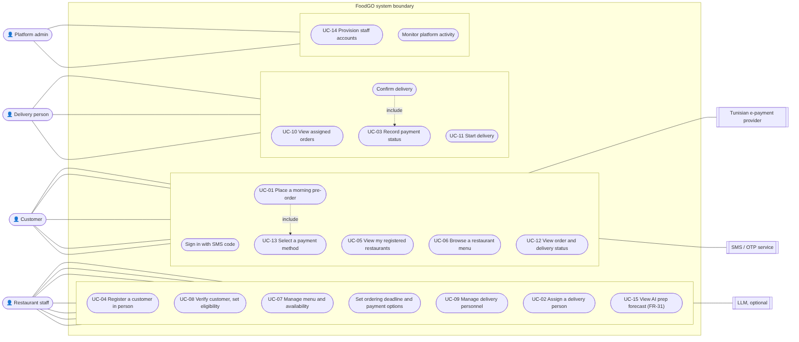
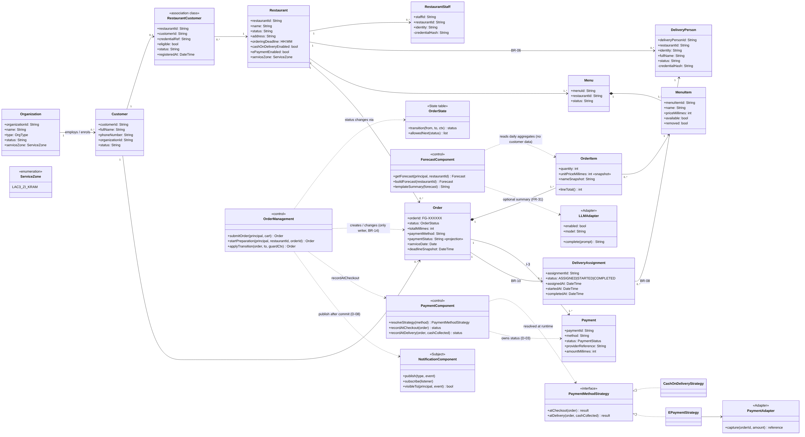
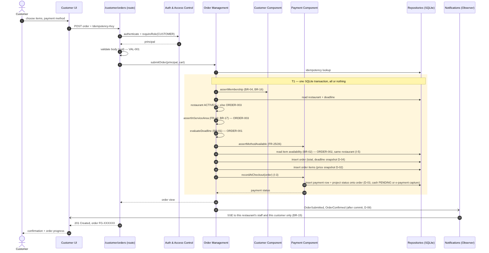
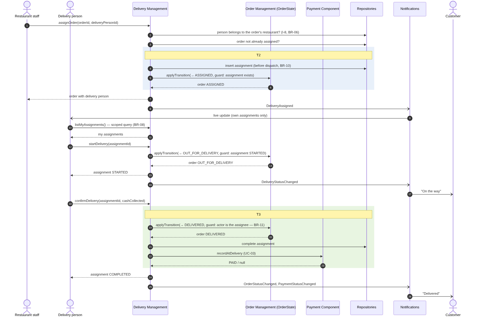
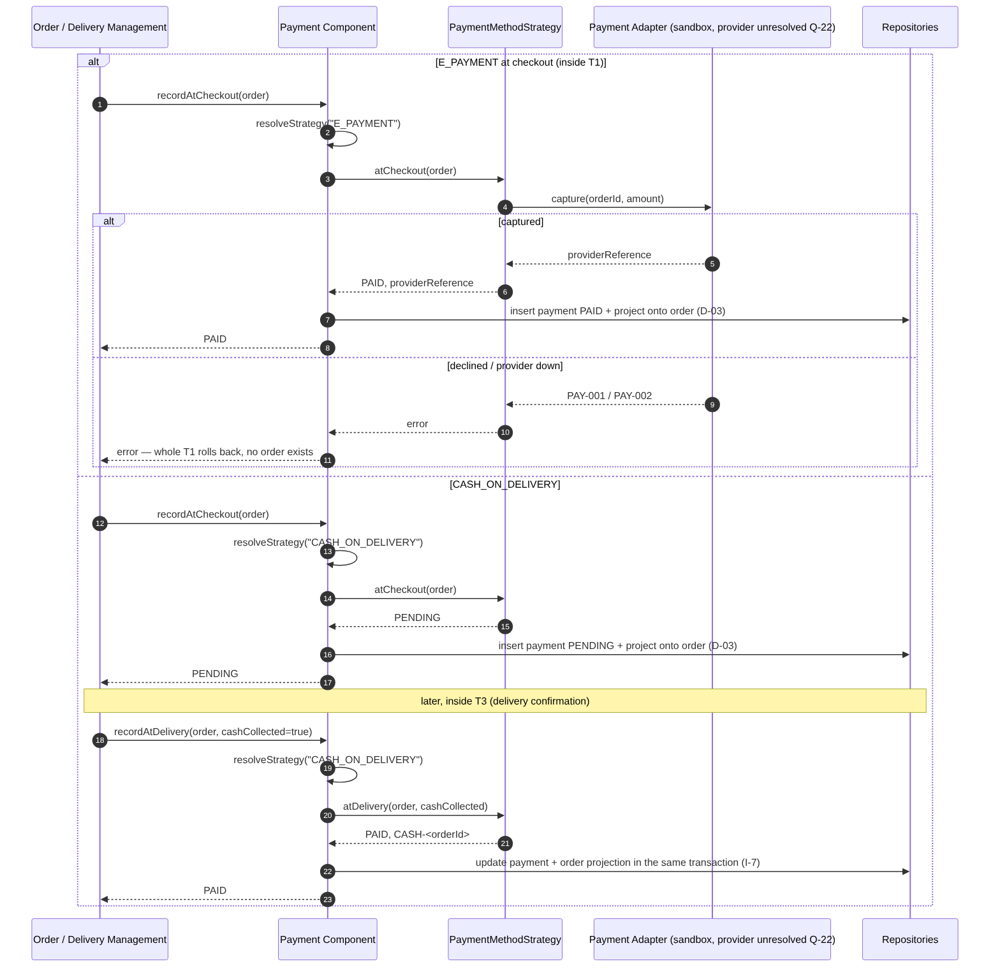
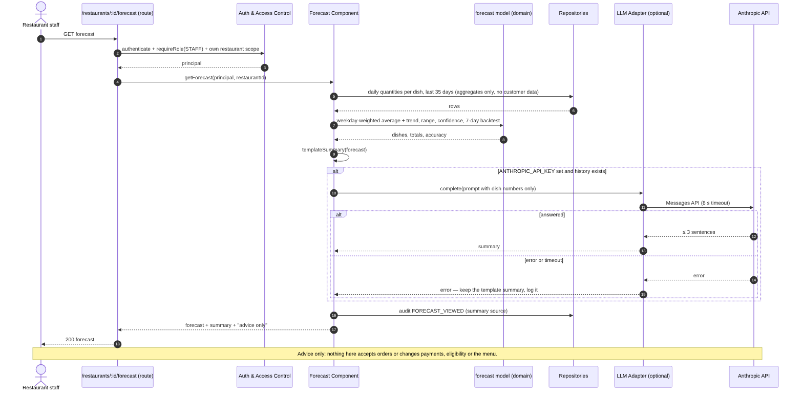
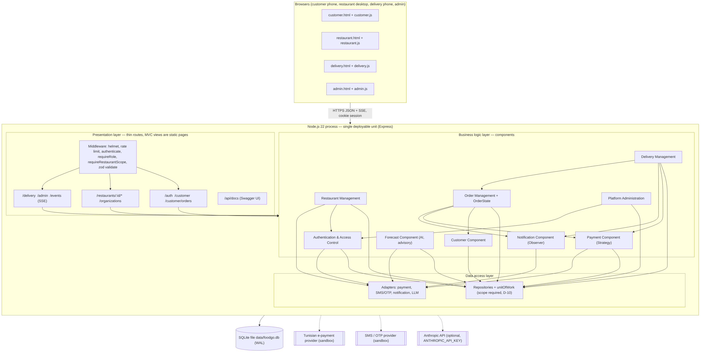

# UML diagrams

Source files are Mermaid (`.mmd`); the PNGs are rendered from them. They follow the Lab 4 SDD and reflect the code as built.

| Diagram | Image | Source | Notes |
|---|---|---|---|
| Use-case |  | [use-case.mmd](use-case.mmd) | UC-01 – UC-15 by actor. UC-01–UC-14 are the SDD register (Appendix A); UC-15 is the AI forecast (FR-31). Mermaid has no native use-case type, so actors are drawn as person nodes. |
| Class |  | [class-diagram.mmd](class-diagram.mmd) | The 12 SDD classes, the control classes that carry the behaviour (Order Management, Payment, Notification, Forecast), and the State, Strategy and Adapter design classes. Revised after the Lab 5 peer review. Money in integer millimes. |
| Sequence — UC-01 place a pre-order |  | [sequence-uc01-place-order.mmd](sequence-uc01-place-order.mmd) | Transaction T1, deadline gate, events after commit |
| Sequence — UC-02 assign and deliver |  | [sequence-uc02-assign-deliver.mmd](sequence-uc02-assign-deliver.mmd) | Transactions T2 and T3, guards BR-10 and BR-11 |
| Sequence — UC-03 payment status |  | [sequence-uc03-payment.mmd](sequence-uc03-payment.mmd) | Strategy + Adapter, rollback on declined payment |
| Sequence — UC-15 AI prep forecast |  | [sequence-uc15-forecast.mmd](sequence-uc15-forecast.mmd) | FR-31: aggregates only, optional LLM with template fallback, audit (added after the Lab 5 peer review) |
| Component / deployment |  | [component-deployment.mmd](component-deployment.mmd) | Layers, components, adapters, SQLite, external services |

Re-render after editing:

```bash
npx -p @mermaid-js/mermaid-cli mmdc -i docs/uml/class-diagram.mmd -o docs/uml/class-diagram.png -b white -s 2
```

## AI assistance

The diagrams were drafted by Claude from the SDD and the code, in the spirit of the course prompt *"Given these user stories, produce PlantUML class and sequence diagrams for the flow including validation and persistence steps"*, then checked against the implementation. Mermaid was used instead of PlantUML because it renders on GitHub without a server.
